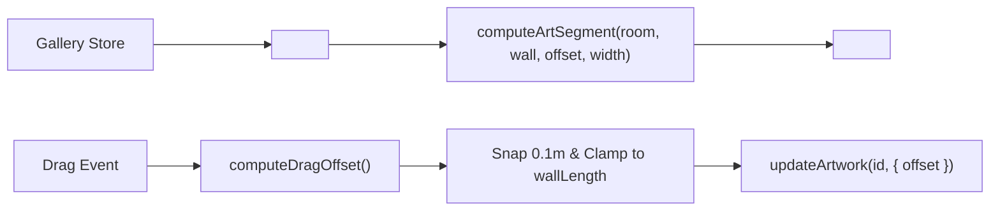

# Handoff: PR-34 / T-043
## Builder notes
### What changed
Implemented `<ArtMarkers />` on branch `feat/T-043-art-markers` (PR #34):
- `src/editor2d/ArtMarkers.tsx`:
  - Visual 2D line tick for each artwork on its room's wall, positioned using plan coordinates.
  - Pointer dragging moves artwork along its wall only, clamped to wall length and snapped to 0.1 m increments.
  - Clicking/pointer-down selects the artwork via `select({ kind: "artwork", id })`.
  - Artworks with compile issues (`compile(gallery).issues`) render in red (`#ef4444`).
  - Selected artwork renders in blue (`#2563eb`).
  - Pure position math `computeArtSegment` and drag math `computeDragOffset` exported and unit-tested.
- `src/editor2d/Canvas.tsx`:
  - Mounted `<ArtMarkers ppm={ppm} />` in meters coordinate space overlaying room shapes.
- `src/editor2d/ArtMarkers.test.tsx`:
  - 9 tests covering pure geometry calculation across all 4 wall orientations (n, s, w, e), delta inversion for south/west walls, clamping, snapping, selection rendering, and compile issue red highlight.

### Diagram


### How to test
```bash
git fetch origin && git switch feat/T-043-art-markers
npm ci
npm test
npm run typecheck
npm run lint
npm run format:check
```

Expected:
- 33/33 test files, 277/277 tests pass.
- TypeScript, ESLint, Prettier clean.
