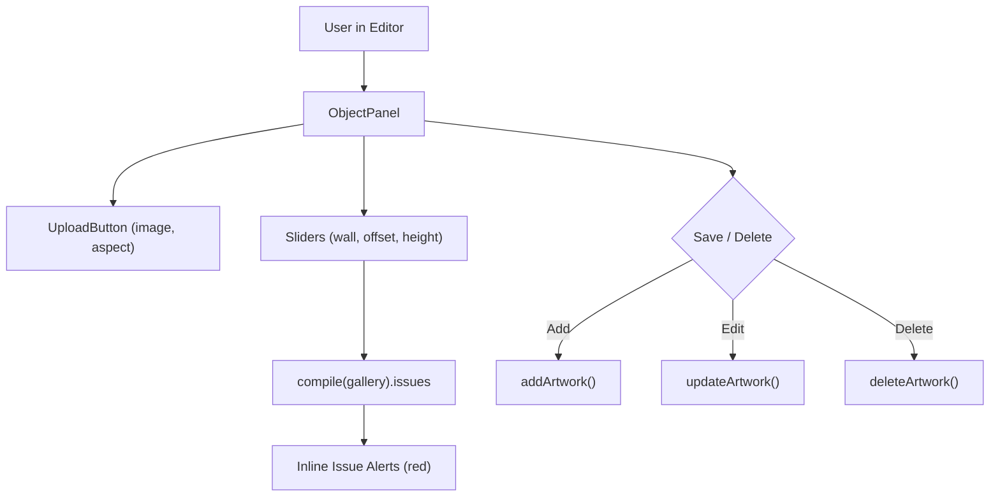

# Handoff: PR-35 / T-042
## Builder notes
### What changed
Implemented `<ObjectPanel />` for adding and editing artwork in `src/panels/ObjectPanel.tsx` on branch `feat/T-042-object-panel` (PR #35):
- Image upload integrated using `<UploadButton />` (from T-041).
- Wall selector (`N`, `E`, `S`, `W`).
- Position along wall slider (`0` to `wallLength`, step `0.1` m) and center height slider (`0` to `wallHeight`, step `0.1` m).
- Dimensions and metadata: width in meters, title, artist, and story description.
- New artwork creation invokes `addArtwork()`, while editing invokes `updateArtwork()`.
- Delete button provided for existing artworks invoking `deleteArtwork()`.
- Inline display of compile issues (`compile(gallery).issues`) for the active artwork next to the offset and height sliders.
- Comprehensive unit tests in `src/panels/ObjectPanel.test.tsx` verifying bounds, creation, editing, and issue rendering.

### Diagram


### How to test
```bash
git fetch origin && git switch feat/T-042-object-panel
npm ci
npm test
npm run typecheck
npm run lint
npm run format:check
```

Expected:
- 32/32 test files, 251/251 tests pass.
- TypeScript, ESLint, Prettier clean.
