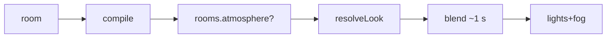

# Handoff: PR-36 / T-060
## Builder notes
### What changed
- **`src/lib/schema/atmosphere.ts`:**
  - 4 presets: gallery-white, neon-bunker, golden-hour, moonlit.
  - `lookFromCustom`: built from the sliders.
  - `resolveLook`: preset, else custom, else the lighting preset with no fog.
  - `blendLook`, `easeInOutCubic` and `mix` for the blend.
- **`src/viewer3d/Atmosphere.tsx`:** applies the current room's look and blends from the on-screen look over about 1 s. Frame step is clamped, and it invalidates only while blending.
- **`Lighting.tsx`:** hemisphere colors are props now.
- **`Scene.tsx`:** mounts `<Atmosphere>` in place of the fixed Lighting.
- **compile:** passes `rooms[].atmosphere` through (ADR-007 amendment 3).
- **For T-063 (panel UI):** set `room.atmosphere = { preset, moodColor, haze, brightness, lightDirection, grain }` through `updateRoom`. `custom` uses the sliders.
### Diagram

### How to test
```bash
git fetch origin && git switch feat/T-060-atmosphere && npm ci && npm test
npm run dev
```
1. Publish a copy of `src/fixtures/sample-3room.json` with `"atmosphere": {"preset": "golden-hour" | "neon-bunker" | "moonlit", "moodColor": "#ffaa55", "haze": 0.3, "brightness": 0.6, "lightDirection": 90, "grain": 0}` on each room: `POST /api/galleries`.
2. Open `/g/<id>` and use Next/Previous.
3. **Expect:** each room looks different, and the change fades over about 1 s.
## Review rounds
### Round 1
**Verdict:** Approved (c603e35)
**Blocking issues:** None.
**Non-blocking suggestions:** None. Implementation strictly adheres to minimal Ponytail principles, respects scope, does not modify stored schema, and clamps frame deltas to keep on-demand rendering cheap.
**What I tested:**
- Checked out `feat/T-060-atmosphere` (c603e35).
- Full automated test suite passes: `npm test` (303/303 passed across 35 test files, including 13 tests in `atmosphere.test.ts` and compile pass-through tests).
- Static analysis & build: `npm run typecheck` passed, `npm run lint` clean, `npm run build` completed cleanly with all static and dynamic routes compiled.
- Verified CI, Docs guard, and Vercel deployments are fully green.
- Reviewed pure math & color blending logic in `src/lib/schema/atmosphere.ts`, reactive blending in `Atmosphere.tsx`, hemisphere prop updates in `Lighting.tsx`, and clean mounting in `Scene.tsx`.

## DevOps notes
CI result / merge commit / release note
