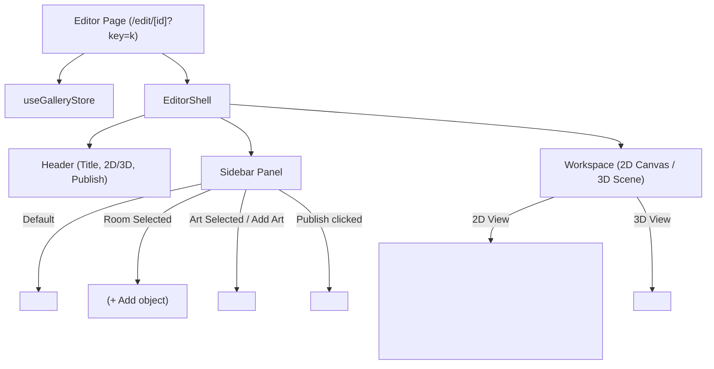

# Handoff: PR-37 / T-046
## Builder notes
### What changed
Wired up the complete Sprint 2 editor experience in `src/app/edit/[id]/page.tsx` on branch `feat/T-046-editor-page-wiring` (PR #37):
- **Artwork editing & addition**:
  - Selecting an artwork in the canvas or list renders `<ObjectPanel />` in the left sidebar.
  - Added `+ Add object` button in `<RoomPanel />` which opens `<ObjectPanel />` for that room.
  - Mounting `<ArtMarkers />` on the 2D canvas with interactive dragging, snapping, and selection.
- **Publish & Save**:
  - Clicking "Publish" in the header opens `<PublishPanel />` in the sidebar.
  - After publishing, the browser URL is updated to `/edit/<id>?key=<k>` via `window.history.replaceState`.
- **Load by link & Error handling**:
  - If navigated to `/edit/<id>?key=<k>`, loads gallery document via `GET /api/galleries/<id>`, validates schema, and sets into store.
  - Shows clear error screen on 404 or invalid document with a return link to the start screen.
  - Key is stored in React memory only and never saved to localStorage.
- **Autosave**:
  - Connected `startAutosave` and `loadAutosave` for local changes under `pegasus:gallery:<id>`.
- **3D Scene Integration**:
  - Configured `<Scene />` with `mode="orbit"`, `onFloorClick`, and `onFrameClick` (selecting artwork).

### Diagram


### How to test
```bash
git fetch origin && git switch feat/T-046-editor-page-wiring
npm ci
npm test
npm run typecheck
npm run lint
npm run format:check
```

Expected:
- 36/36 test files, 311/311 tests pass.
- TypeScript, ESLint, and Prettier clean.

### Round 1 (reviewer, 2026-10-10): APPROVED
0 blocking. Full publish -> reload edit link -> edit -> save flow passed in Playwright; wrong key refused; 404 page; key never in localStorage or responses. Bundled files identical to #33/#34/#35. Merge order: #35, #34, then #37 after a main merge. Non-blocking: no-referrer on the edit route (key in URL).
