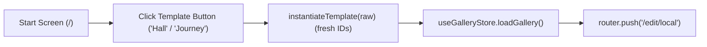

# Handoff: PR-38 / T-062
## Builder notes
### What changed
Added starter templates and enabled the template buttons on the start screen on branch `feat/T-062-templates` (PR #38):
- **Template fixtures**:
  - `src/fixtures/templates/single-hall.json`: one spacious hall (12 × 8 m, height 4 m, concrete floor, gallery lighting).
  - `src/fixtures/templates/three-room-journey.json`: three connected rooms with distinct wall colors, heights, and lighting (entrance, east hall, south alcove).
  - Both pass `validate` with no artworks.
- **Template helper & start screen**:
  - `src/fixtures/templates/index.ts`: defines `TEMPLATES` and `instantiateTemplate` which clones the template with fresh gallery and room IDs and updated timestamps.
  - `src/app/page.tsx`: replaces the disabled template buttons with active buttons for each template that load the instantiated document into store and navigate to `/edit/local`.
- **Tests**:
  - `src/app/page.test.tsx`: validates that templates render enabled on start screen, pass `validate()`, and generate fresh IDs on each instantiation.

### Diagram


### How to test
```bash
git fetch origin && git switch feat/T-062-templates
npm ci
npm test
npm run typecheck
npm run lint
npm run format:check
```

Expected:
- 36/36 test files, 310/310 tests pass.
- TypeScript, ESLint, and Prettier clean.
