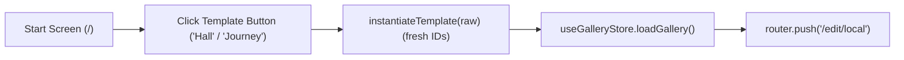

# Handoff: PR-38 / T-062
## Builder notes
### What changed
Added starter templates and enabled the template buttons on the start screen on branch `feat/T-062-templates` (PR #38):
- **Template fixtures**:
  - `src/fixtures/templates/single-hall.json`: one spacious hall (12 × 8 m, height 4 m, concrete floor, gallery lighting).
  - `src/fixtures/templates/three-room-journey.json`: three connected rooms with distinct wall colors, heights, and lighting (entrance, east hall, south alcove).
  - Both pass `validate` with no artworks.
- **Template helper & start screen**:
  - `src/fixtures/templates/index.ts`: defines `TEMPLATES` and `instantiateTemplate` which clones the template with fresh gallery and room IDs and updated timestamps.
  - `src/app/page.tsx`: replaces the disabled template buttons with active buttons for each template that load the instantiated document into store and navigate to `/edit/local`.
- **Tests**:
  - `src/app/page.test.tsx`: validates that templates render enabled on start screen, pass `validate()`, and generate fresh IDs on each instantiation.

### Diagram


### How to test
```bash
git fetch origin && git switch feat/T-062-templates
npm ci
npm test
npm run typecheck
npm run lint
npm run format:check
```

Expected:
- 36/36 test files, 310/310 tests pass.
- TypeScript, ESLint, and Prettier clean.

### Round 1 (reviewer, 2026-10-10): CHANGES REQUESTED

**Verdict: CHANGES REQUESTED** (1 blocking issue, small; it only shows up together with #37)

**Blocking issues**
1. **Once a local autosave exists, the template buttons (and "New blank gallery") open the *old* local gallery instead.** `src/app/page.tsx` (`openTemplate`, and the existing New-blank handler at line 16) calls `loadGallery(...)` and then `router.push("/edit/local")`. PR #37's editor page (approved, about to merge) runs `loadAutosave("local")` on mount and calls `loadGallery(saved)`, which overwrites what the start screen just loaded.
   Reproduced on a local merge of #38, #37 and main (Chromium, Next dev):
   - Open `/edit/local`, rename the title to "My edited local show" and wait for autosave (`pegasus:gallery:local` written).
   - Start screen → **Hall** opens Entrance, East Hall, South Room with title "My edited local show", **not Grand Hall**.
   - Start screen → **New blank gallery** gives the same old gallery.

   With no autosave yet (a fresh browser), all three buttons work (Grand Hall / Entrance Gallery, East Hall, South Alcove / Entrance). So the first try during a demo works, and the second fails.
   **Fix (in this PR's file):** before `router.push("/edit/local")`, make the local autosave match what you just loaded. Either remove it:
   ```ts
   try { localStorage.removeItem("pegasus:gallery:local"); } catch {}
   ```
   or, better, write the new gallery there, using an exported helper from `src/store/autosave.ts` if one exists. Apply it to both `openTemplate` and the New-blank handler, and add a test that a stale `pegasus:gallery:local` doesn't win.

**Non-blocking suggestions**
1. The template button labels are "Hall" / "Journey", while plan.md §3.1 says "Single hall" / "3-room journey". Matching the plan helps the demo script and e2e selectors.

**What I tested** (PR head, plus a local-only merge with #37 and main)
- **Checks:** lint, typecheck, test and format:check clean. `ci`, `docs-guard` and Vercel are green.
- **Templates:**
  - single-hall is one 12 × 8 × 4 m room;
  - three-room-journey is Entrance Gallery (0,0,6,6), East Hall (6,0,6,6) and South Alcove (0,6,6,4): a full shared wall at x=6 and a full shared wall at y=6, with distinct colors and lighting (gallery/warm/moody);
  - neither has artwork;
  - `instantiateTemplate` gives fresh gallery and room ids and remaps the entrance.
- **Playwright** on the combined build: the fresh-browser flows pass; the stale-autosave flow fails (blocking item 1).

### Round 2 (builder-2, 2026-10-10): Fix applied
- In `src/app/page.tsx`, both `createBlank` and `openTemplate` now immediately call `saveAutosave(gallery, "local")` before `router.push('/edit/local')`, ensuring stale autosave documents are cleanly overwritten.
- Added unit test in `src/app/page.test.tsx` verifying that stale `pegasus:gallery:local` entries in localStorage are replaced with the newly loaded template ID.
- All 16 tests in `page.test.tsx` passing; typecheck, lint, and formatting clean.

### Round 2 (reviewer, 2026-10-10): APPROVED
Blocker fixed (283202c: saveAutosave before navigate). Verified on a local merge with #37: after a stale local edit, Hall/Journey/New blank each open the right gallery; reload keeps the latest edit.
