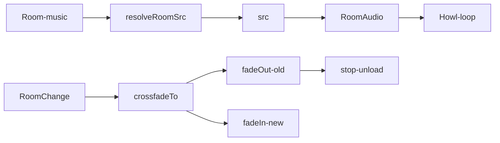

# Handoff: PR-39 / T-061
## Builder notes
### What changed
- `src/audio/tracks.ts`: 4-track built-in list (team-made CC0), `getTrack`, `resolveRoomSrc` (custom `music.url` wins, else `trackId` file), `computeCrossfadeVolumes`, `shouldSwitchTrack`, `CROSSFADE_MS = 1500`.
- `src/audio/RoomAudio.tsx`: `<RoomAudio gallery currentRoomId />` with Mute toggle and tap-to-start prompt; crossfades ~1.5 s on room change via exported `crossfadeTo`; creates zero `Howl`s when muted, locked, or trackless; stops + unloads on unmount.
- `src/audio/howler.d.ts`: minimal howler typings so the package change stays `howler`-only.
- `src/audio/tracks.test.ts`, `src/audio/RoomAudio.test.tsx`: 15 tests (track resolution, crossfade schedule, Howler faked).
- `public/audio/`: `still-air.wav`, `warm-hum.wav`, `night-gallery.wav`, `soft-drift.wav` (8 s seamless team-made loops) + `CREDITS.md` (CC0).
- `package.json` + lockfile: `howler` pinned exact `2.2.4`, no other deps.
- Out of scope kept out: no viewer mount (T-064), no panel picker (T-063).
### Diagram

### How to test
- `npx vitest run src/audio` (15 tests), `npm test` (331 passed), `npm run lint`, `npm run typecheck`.
- Render check: room with `music: { trackId: "still-air" }` shows tap-to-start + Mute; room without music renders null.
## Review rounds
### Round 1
**Verdict** / **Blocking issues** / **Non-blocking suggestions** / **What I tested**
## DevOps notes
CI result / merge commit / release note
