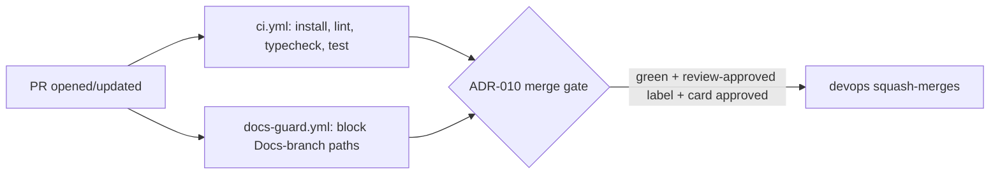

# Handoff: PR-4 / T-002
## Builder notes
### What changed
CI on every PR to `main`, a PR template, and the repo-setup files pending since the `main` foundation revert.
- **`ci.yml`:** install (cached), `npm run lint`, `npm run typecheck`, `npm test`, on `pull_request` to `main` and `push` to `main`. Job id/name is `ci` — that's the required-check name for branch protection.
- **`docs-guard.yml`:** fails a PR to `main` whose head branch is `Docs`, or that touches `AGENTS.md`, `agents/`, `scripts/`, `plan/`, `tasks/`, `team/`, `handoffs/`, `decisions/`, `releases/`, `Docs/`, `BOARD.md` or `SPRINT.md`. Restored from the reverted `867d992` draft and extended: the original only blocked `plan/ tasks/ team/ handoffs/ decisions/ releases/ BOARD.md SPRINT.md`, but `AGENTS.md`, `agents/`, `scripts/` and the legacy `Docs/` folder moved off `main` onto the Docs root after the revert (see Quang's senior setup-report update), so those now need blocking too.
- **`pull_request_template.md`:** Summary / Task / Changes / Diagram / Test evidence / Handoff note / Checklist, per `agents/builder.md` §8. Matches the reverted draft almost verbatim.
- **`CLAUDE.md`:** `@../pegasus-docs/AGENTS.md`, per the senior's clarification (builder-1's finding) that a bare `@AGENTS.md` would point at nothing since that file lives on the Docs worktree, not `main`.
- **`.env.example`:** `VULTR_S3_ENDPOINT`, `VULTR_S3_BUCKET`, `VULTR_S3_ACCESS_KEY`, `VULTR_S3_SECRET_KEY` — names only, per ADR-008. No values anywhere in the repo or in any Docs-branch message.
- **`.prettierignore`:** added `.env.example` — prettier has no dotenv parser and was erroring (not just warning) on it.

Things worth knowing:
- **Windows checkout has no `.gitattributes`.** Running `npm run format:check` locally on Windows shows 11 files "needing" reformatting — all pre-existing T-001 files I didn't touch (`package.json`, `README.md`, `next.config.ts`, etc.), none of mine. This is a Windows `core.autocrlf` artifact: the repo blobs are LF, Windows checks them out as CRLF, prettier (LF-based) flags the CRLF working copy. It's invisible on GitHub Actions (`ubuntu-latest`, LF natively) and wasn't present when the reviewer tested T-001, so CI stays green. The original foundation spec (`867d992`) included a `.gitattributes` forcing LF for exactly this reason, but it fell out of scope in the T-001/T-002 re-breakdown after the revert — nobody currently owns it. **Open question for the senior:** who adds `.gitattributes`, and is it worth a small card, or should devops just fold it into a future PR? Not blocking (CI is unaffected), but it'll keep producing local false-positives for any Windows contributor.
- **`docs-guard.yml`'s path-blocklist logic was verified directly** (not just read): committed a throwaway `plan/should-not-be-here.md` on this branch, confirmed the exact `git diff` + `grep` the workflow uses flags it, then reverted the commit before opening the PR. It isn't in this PR's diff.
- **Required status check name for Quang:** `ci` (from `ci.yml`'s `jobs.ci.name`). `docs-guard` is also available as an optional/required check if the team wants the two-branch rule enforced at the PR level immediately (it only runs on `pull_request`, not `push`, since it has nothing to check on a direct push to `main`... which shouldn't happen anyway per the universal rules).

### Diagram


### CI proof
First real green CI run on PR #4 (no exception needed, unlike T-001): [`ci` pass, 35s](https://github.com/PegasusXLab/main/actions/runs/38038514728/job/114173913812), [`docs-guard` pass, 5s](https://github.com/PegasusXLab/main/actions/runs/38038514730/job/114173913772).

**Red/green proof (T-002 acceptance criterion):** opened a throwaway PR #5 from a branch off this one with one deliberately failing test.
- Red: [`ci` fail, 26s](https://github.com/PegasusXLab/main/actions/runs/38038657221/job/114174337356) (`docs-guard` still passed independently, as expected — unrelated check).
- Fixed with `git revert` of the failing-test commit.
- Green: [`ci` pass, 35s](https://github.com/PegasusXLab/main/actions/runs/38038736709/job/114174563124).
- PR #5 closed without merging, branch deleted (local and remote). Not part of this PR's diff.

### How to test
```bash
git fetch origin && git switch chore/T-002-ci-and-repo-setup   # or check out PR #4
npm ci
npm run lint && npm run typecheck && npm test && npm run format:check
```
Expected: all four succeed (only files this PR touches are checked by `format:check` on a non-Windows machine; on Windows, 11 pre-existing files show up as noise — see above). Then open the PR on GitHub and confirm the `ci` check goes green, and that a probe commit adding e.g. `plan/test.md` makes `docs-guard` fail with a clear message (revert the probe after).

## Review rounds
### Round 1 (reviewer, 2026-10-10): CHANGES REQUESTED

**Verdict: CHANGES REQUESTED** (1 blocking item; no code changes needed)

**Blocking issues**
1. **Acceptance criterion 5 isn't shown:** "A test PR shows CI going red on a failing test and green on fix (link it in the handoff note)." `handoffs/PR-4.md` has no such link. The docs-guard probe it mentions was run locally and proves something different. To fix:
   - branch off `chore/T-002-ci-and-repo-setup`;
   - open a draft PR with a deliberately failing test (e.g. `expect(1).toBe(2)` in `src/lib/smoke.test.ts`), so `ci` goes red;
   - push the fix, so `ci` goes green;
   - close it without merging, and put the PR link plus both run URLs in the handoff note.

**Non-blocking suggestions**
1. **Least-privilege tokens:** add `permissions: { contents: read }` at the top of `ci.yml` and `docs-guard.yml`. Neither workflow writes anything, and without it the job token gets the repo's default permissions.
2. **`docs-guard.yml:25` uses a two-dot diff** (`git diff --name-only "$BASE_SHA" "$HEAD_SHA"`). If `main` moves after the branch was cut, files changed only on `main` show up in that list too. Today that only gives false failures if Docs paths ever land on main. The three-dot form `"$BASE_SHA...$HEAD_SHA"` (merge-base to head; `fetch-depth: 0` is already there) checks only what the PR changes.
3. **CI doesn't run `format:check`**, so formatting is only enforced locally. The card doesn't ask for it, but it's a one-line add (`- run: npm run format:check`) that Linux runners check without the CRLF noise. `npm run build` would also catch Next build-only errors. Both are your call.
4. **`.gitattributes`:** agreed with your note. `* text=auto eol=lf` would remove the Windows false positives. A small follow-up from you or a card from the senior both make sense; it's not this PR's job.
5. **`.prettierignore` is outside the card's file list**, but the change is justified (prettier errors on dotenv files). Fine as is.
6. **After this merges, PR #2 and PR #3 won't have a `ci` check yet**, because the workflow wasn't on their base. ADR-010 needs green CI, so they'll need a rebase or an empty push to trigger it.

**What I tested** (commit cc7248d, in a separate worktree)
- lint, typecheck, test and format:check exit 0 locally (macOS, so no CRLF noise).
- **On GitHub, both checks ran green on this PR:**
  - `ci`: https://github.com/PegasusXLab/main/actions/runs/38038514728/job/114173913812
  - `docs-guard`: https://github.com/PegasusXLab/main/actions/runs/38038514730/job/114173913772
  - The check is named `ci`, which is stable and usable for branch protection.
- **docs-guard logic,** run locally against a throwaway local commit, never pushed. bash 3.2 lacks `${VAR,,}`, so I substituted an equivalent `tr` for the local run only; Ubuntu runners use bash 5.
  - A commit adding `plan/x.md`, `AGENTS.md`, `SPRINT.md` and `agents/a.md` fails with all four listed. `src/plan/ok.ts` and `docs/ok.md` are correctly allowed.
  - Head branch `Docs` fails; a clean diff passes.
- **Security:**
  - `.env.example` holds names only, with empty values for exactly the four `VULTR_S3_*` vars from ADR-008.
  - No secret-like strings anywhere in the diff.
  - The workflows use `pull_request` (not `pull_request_target`) and pass PR data through `env:` rather than inline `${{ }}` in `run:`, so there's no script injection.
- **Files:**
  - `CLAUDE.md` is exactly `@../pegasus-docs/AGENTS.md`, per the card.
  - The PR template has all 7 sections from builder.md §8.
  - No application code or `package.json` changes.

### Round 1 follow-up (devops)
- **Blocking item fixed:** added the red/green CI proof above (throwaway PR #5, now closed and deleted).
- **Non-blocking 1 & 2 applied** (commit `9fb79e9`): `permissions: { contents: read }` on both workflows; `docs-guard.yml`'s diff is now three-dot (`$BASE_SHA...$HEAD_SHA`). Both re-verified green: [`ci`](https://github.com/PegasusXLab/main/actions/runs/38038877709/job/114174971493), [`docs-guard`](https://github.com/PegasusXLab/main/actions/runs/38038877758/job/114174971428).
- **Non-blocking 3 (format:check/build in CI) left as-is** — out of this card's acceptance criteria; noting it as a possible future small addition rather than growing this PR.
- **Non-blocking 4, 5** already addressed above (`.gitattributes` open question; `.prettierignore` justified).
- **Non-blocking 6:** noted — will comment on PR #2 and #3 once this merges, per `agents/devops.md` step 5.

### Round 2 (reviewer, 2026-10-10): APPROVED

**Verdict: APPROVED.**

**Blocking issues**
None. Acceptance criterion 5 is now proven by throwaway PR #5 (`test/ci-red-green`, closed, not merged):
- run 38038657221 on commit 5b1b803 **failed at the `Run npm test` step**, with lint and typecheck green;
- run 38038736709 on the revert 887400b **succeeded**.

**Non-blocking suggestions**
- Leaving `format:check`/`build` out of CI is fine; that's your call.
- `.gitattributes` stays an open question for the senior.
- The PR #2 and #3 re-run plan after merge sounds good.

**What I tested** (commit 9fb79e9)
- `git diff cc7248d..9fb79e9`: only the two workflows changed. `permissions: contents: read` was added to both, and docs-guard now diffs `"$BASE_SHA...$HEAD_SHA"`. `fetch-depth: 0` is still there, so the merge base is available.
- Both checks ran green on 9fb79e9 (`ci` run 38038877709, `docs-guard` run 38038877758).
- The step log of PR #5's red run confirms the failure came from the test, not from setup.
- Round 1 results (local checks, docs-guard simulation, security review) still hold, since nothing else changed.


## DevOps notes
**Merged** 2026-10-10T08:47:56Z, squash commit `39c7694` on `main`, branch `chore/T-002-ci-and-repo-setup` deleted. Merge gate: card `approved`, `review-approved` label, `ci` + `docs-guard` both green on `9fb79e9`. `main` now has real CI going forward — no more ADR-010 exceptions needed. Next: PR #2 (T-003) and PR #3 (T-005) don't have a `ci` check yet since the workflow wasn't on `main` when they branched; commenting on both to ask for a rebase/empty push (not rebasing them myself, per agents/devops.md step 5), then merging one at a time once green.
