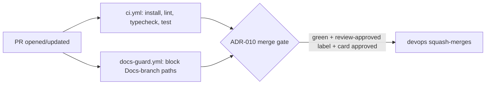

# Handoff: PR-4 / T-002
## Builder notes
### What changed
CI on every PR to `main`, a PR template, and the repo-setup files pending since the `main` foundation revert.
- **`ci.yml`:** install (cached), `npm run lint`, `npm run typecheck`, `npm test`, on `pull_request` to `main` and `push` to `main`. Job id/name is `ci` — that's the required-check name for branch protection.
- **`docs-guard.yml`:** fails a PR to `main` whose head branch is `Docs`, or that touches `AGENTS.md`, `agents/`, `scripts/`, `plan/`, `tasks/`, `team/`, `handoffs/`, `decisions/`, `releases/`, `Docs/`, `BOARD.md` or `SPRINT.md`. Restored from the reverted `867d992` draft and extended: the original only blocked `plan/ tasks/ team/ handoffs/ decisions/ releases/ BOARD.md SPRINT.md`, but `AGENTS.md`, `agents/`, `scripts/` and the legacy `Docs/` folder moved off `main` onto the Docs root after the revert (see Quang's senior setup-report update), so those now need blocking too.
- **`pull_request_template.md`:** Summary / Task / Changes / Diagram / Test evidence / Handoff note / Checklist, per `agents/builder.md` §8. Matches the reverted draft almost verbatim.
- **`CLAUDE.md`:** `@../pegasus-docs/AGENTS.md`, per the senior's clarification (builder-1's finding) that a bare `@AGENTS.md` would point at nothing since that file lives on the Docs worktree, not `main`.
- **`.env.example`:** `VULTR_S3_ENDPOINT`, `VULTR_S3_BUCKET`, `VULTR_S3_ACCESS_KEY`, `VULTR_S3_SECRET_KEY` — names only, per ADR-008. No values anywhere in the repo or in any Docs-branch message.
- **`.prettierignore`:** added `.env.example` — prettier has no dotenv parser and was erroring (not just warning) on it.

Things worth knowing:
- **Windows checkout has no `.gitattributes`.** Running `npm run format:check` locally on Windows shows 11 files "needing" reformatting — all pre-existing T-001 files I didn't touch (`package.json`, `README.md`, `next.config.ts`, etc.), none of mine. This is a Windows `core.autocrlf` artifact: the repo blobs are LF, Windows checks them out as CRLF, prettier (LF-based) flags the CRLF working copy. It's invisible on GitHub Actions (`ubuntu-latest`, LF natively) and wasn't present when the reviewer tested T-001, so CI stays green. The original foundation spec (`867d992`) included a `.gitattributes` forcing LF for exactly this reason, but it fell out of scope in the T-001/T-002 re-breakdown after the revert — nobody currently owns it. **Open question for the senior:** who adds `.gitattributes`, and is it worth a small card, or should devops just fold it into a future PR? Not blocking (CI is unaffected), but it'll keep producing local false-positives for any Windows contributor.
- **`docs-guard.yml`'s path-blocklist logic was verified directly** (not just read): committed a throwaway `plan/should-not-be-here.md` on this branch, confirmed the exact `git diff` + `grep` the workflow uses flags it, then reverted the commit before opening the PR. It isn't in this PR's diff.
- **Required status check name for Quang:** `ci` (from `ci.yml`'s `jobs.ci.name`). `docs-guard` is also available as an optional/required check if the team wants the two-branch rule enforced at the PR level immediately (it only runs on `pull_request`, not `push`, since it has nothing to check on a direct push to `main`... which shouldn't happen anyway per the universal rules).

### Diagram


### How to test
```bash
git fetch origin && git switch chore/T-002-ci-and-repo-setup   # or check out PR #4
npm ci
npm run lint && npm run typecheck && npm test && npm run format:check
```
Expected: all four succeed (only files this PR touches are checked by `format:check` on a non-Windows machine; on Windows, 11 pre-existing files show up as noise — see above). Then open the PR on GitHub and confirm the `ci` check goes green, and that a probe commit adding e.g. `plan/test.md` makes `docs-guard` fail with a clear message (revert the probe after).

## Review rounds
(filled in by the reviewer)

## DevOps notes
(filled in at merge)
