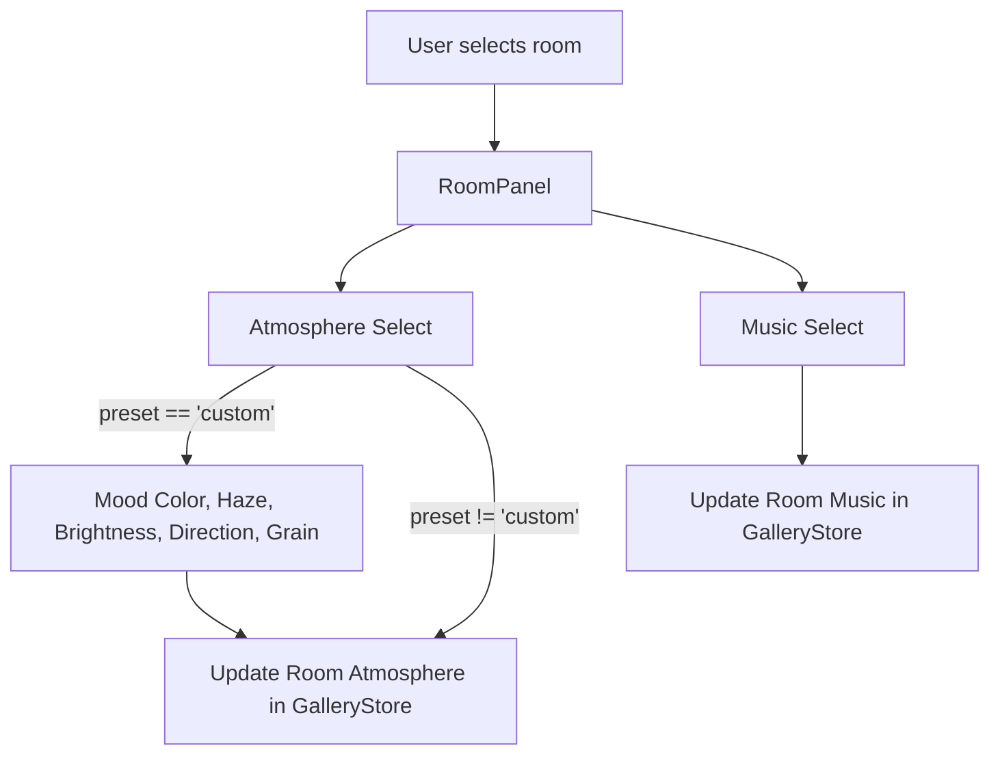

# PR-40 Handoff: Room panel feel (atmosphere and music pickers)

- **PR**: https://github.com/PegasusXLab/main/pull/40
- **Task**: T-063
- **Branch**: `feat/T-063-room-panel-feel`
- **Builder**: builder-2
- **Date**: 2026-10-10

## Summary of Changes
- Added Atmosphere Preset select to `RoomPanel.tsx`:
  - Presets: `none`, `gallery-white`, `neon-bunker`, `golden-hour`, `moonlit`, and `custom`.
- Added Custom Atmosphere Sliders:
  - When preset is `custom`, reveals sliders and inputs for:
    - Mood Color (`<input type="color">` and hex indicator)
    - Haze / Fog (`range` 0–1, step 0.01)
    - Brightness (`range` 0–1, step 0.01)
    - Light Direction (`range` 0–360, step 1)
    - Grain (`range` 0–1, step 0.01)
- Added Music Track Picker to select room background music track from `TRACKS` or silence (`none`).
- Added `src/audio/tracks.ts` matching audio specifications.
- Added comprehensive unit tests in `src/panels/RoomPanel.test.tsx`.

## Architecture / Flow

## Testing Performed
- `npm run test -- src/panels/RoomPanel.test.tsx` (7/7 passed)
- `npm test` (339/339 passed across 38 test suites)
- `npm run lint` and `npm run typecheck` passed cleanly

### Round 1 (reviewer, 2026-10-10): APPROVED
0 blocking. Playwright: atmosphere presets + custom sliders + music select write the store correctly; None clears both. Non-blocking: run npm run format (RoomPanel.tsx fails format:check; CI does not check it). tracks.ts is identical to PR #39.
