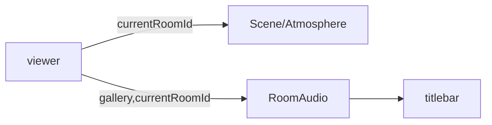

# Handoff: PR-41 / T-064
## Builder notes
### What changed
- **`src/app/g/[id]/page.tsx`:** the viewer title bar mounts T-061's `<RoomAudio gallery currentRoomId />` (tap to start, crossfade, Mute) on the right.
- **Clicks:** the header still ignores clicks (`pointer-events-none`), so they reach the scene; the audio controls are clickable.
- **Atmosphere:** already follows the current room through Scene (T-060).
### Diagram

### How to test
```bash
git fetch origin && git switch feat/T-064-viewer-feel && npm ci && npm test && npm run dev
```
1. Publish a copy of the sample with `"music": {"trackId": "still-air" | "warm-hum" | "night-gallery"}` and an `atmosphere` preset on each room (`POST /api/galleries`).
2. Open `/g/<id>` and tap "Tap to start sound".
3. **Expect:**
   - each room plays its own track, crossfading on Next/Previous;
   - Mute silences and shows "Unmute";
   - each room looks different.
**Card AC 2 (live):** after merge, walk 3 rooms on https://galliverse.vercel.app/ and check look, sound and mute.
## Review rounds
### Round 1
**Verdict:** Approved (4df7bfb)
**Blocking issues:** None.
**Non-blocking suggestions:** None. Exemplary minimal diff: 6 additions, 1 deletion in `src/app/g/[id]/page.tsx`. Header layout nicely separates title from interactive audio controls while preserving `pointer-events-none` on the backdrop to keep 3D scene interactions unblocked.
**What I tested:**
- Checked out PR branch `feat/T-064-viewer-feel` (4df7bfb).
- Ran automated test suite: `npm test` passed (352/352 tests passed across 40 files).
- Static analysis: `npm run typecheck` and `npm run lint` clean with zero errors.
- CI/CD checks: Vercel Preview, CI/ci workflow, and docs-guard all green.
- Verified click event delegation (`pointer-events-none` on header, `pointer-events-auto` on `<RoomAudio>`) and reactive room tracking via `currentRoomId={roomId}`.

## DevOps notes
CI result / merge commit / release note

## DevOps completion
- Approved card and review-approved label verified; ci and docs-guard SUCCESS. Squash merged as 628d269169b64086c9318d9a9d1f3240d56219f3; branch deleted and card immediately marked merged.
- Monitoring automatic main CI/Vercel. Senior owns the live three-room look/sound/mute checkpoint.
