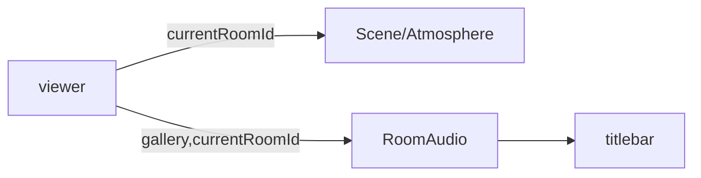

# Handoff: PR-41 / T-064
## Builder notes
### What changed
- **`src/app/g/[id]/page.tsx`:** the viewer title bar mounts T-061's `<RoomAudio gallery currentRoomId />` (tap to start, crossfade, Mute) on the right.
- **Clicks:** the header still ignores clicks (`pointer-events-none`), so they reach the scene; the audio controls are clickable.
- **Atmosphere:** already follows the current room through Scene (T-060).
### Diagram

### How to test
```bash
git fetch origin && git switch feat/T-064-viewer-feel && npm ci && npm test && npm run dev
```
1. Publish a copy of the sample with `"music": {"trackId": "still-air" | "warm-hum" | "night-gallery"}` and an `atmosphere` preset on each room (`POST /api/galleries`).
2. Open `/g/<id>` and tap "Tap to start sound".
3. **Expect:**
   - each room plays its own track, crossfading on Next/Previous;
   - Mute silences and shows "Unmute";
   - each room looks different.
**Card AC 2 (live):** after merge, walk 3 rooms on https://galliverse.vercel.app/ and check look, sound and mute.
## Review rounds
### Round 1
**Verdict** / **Blocking issues** / **Non-blocking suggestions** / **What I tested**
## DevOps notes
CI result / merge commit / release note
