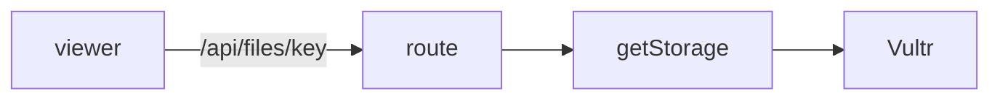

# Handoff: PR-42 / T-072
## Builder notes
### What changed
- **`VultrStorage.publicUrl`** returns same-origin `/api/files/<key>` instead of the bucket URL. Vultr has no CORS, so WebGL blocked the textures.
- **`GET /api/files/[...key]`** already serves through the active adapter (Vultr in production) with type and immutable cache headers, 404 for private or missing objects, and 400 for traversal.
- **New route tests** use a faked Vultr adapter.
- **Outside the card's file list:** one expectation in `storage.test.ts` changed to the new URL shape.
- **Galleries published before this fix** keep their absolute Vultr URLs; re-upload the image to fix one.
### Diagram

### How to test
```bash
git fetch origin && git switch feat/T-072-same-origin-images && npm ci && npm test
```
**Live check after merge:** upload a colorful image in the editor, hang it, publish, open the view link, and confirm the frame shows the picture with no CORS errors.
## Review rounds
### Round 1
**Verdict** / **Blocking issues** / **Non-blocking suggestions** / **What I tested**
## DevOps notes
CI result / merge commit / release note
