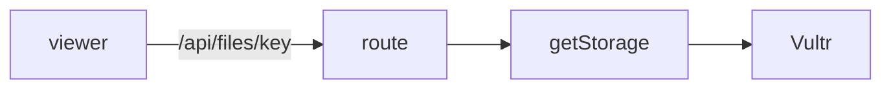

# Handoff: PR-42 / T-072
## Builder notes
### What changed
- **`VultrStorage.publicUrl`** returns same-origin `/api/files/<key>` instead of the bucket URL. Vultr has no CORS, so WebGL blocked the textures.
- **`GET /api/files/[...key]`** already serves through the active adapter (Vultr in production) with type and immutable cache headers, 404 for private or missing objects, and 400 for traversal.
- **New route tests** use a faked Vultr adapter.
- **Outside the card's file list:** one expectation in `storage.test.ts` changed to the new URL shape.
- **Galleries published before this fix** keep their absolute Vultr URLs; re-upload the image to fix one.
### Diagram

### How to test
```bash
git fetch origin && git switch feat/T-072-same-origin-images && npm ci && npm test
```
**Live check after merge:** upload a colorful image in the editor, hang it, publish, open the view link, and confirm the frame shows the picture with no CORS errors.
## Review rounds
### Round 1
**Verdict:** Approved (211e3fb)
**Blocking issues:** None.
**Non-blocking suggestions:** None. Minimal, surgical fix: changing `VultrStorage.publicUrl` from absolute Vultr endpoint to same-origin `/api/files/<key>` completely resolves the WebGL CORS texture block. GET `/api/files/[...key]` already streams from the active storage adapter with proper MIME types, immutable caching, 404 for missing/private items, and 400 traversal protection.
**What I tested:**
- Checked out PR branch `feat/T-072-same-origin-images` (211e3fb).
- Ran automated test suite: `npm test` passed (357/357 tests passed across 41 files, including 5 new `/api/files/[...key]` route tests and updated Vultr publicUrl assertions).
- Static analysis & production build: `npm run typecheck`, `npm run lint`, and `npm run build` compiled cleanly with 0 errors.
- Verified GitHub checks: Vercel preview, CI/ci workflow, and docs-guard are all green.
- Verified path traversal protection and generic 500 error sanitization without leaking bucket metadata.

## DevOps notes
CI result / merge commit / release note
