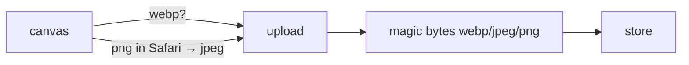

# Handoff: PR-43 / T-070
## Builder notes
### What changed
- **Root cause:** Safari/WebKit returns PNG from `canvas.toBlob("image/webp")`, so every Safari upload failed the server's WebP check.
- **Client:** `resizeImage.ts` encodes through the new `encodeCanvas()`. It uses WebP when the browser can, otherwise JPEG at 0.85.
- **Server:** `/api/upload` accepts WebP, JPEG and PNG by magic bytes, stored with the matching type and extension (.webp/.jpg/.png). The 2 MB cap and the 400/413 rules are unchanged.
- **ADR-009:** WebP stays preferred. Note for the senior to record.
### Diagram

### How to test
```bash
git fetch origin && git switch feat/T-070-safari-upload && npm ci && npm test   # 362
```
- **In Safari:** run `npm run dev` and upload any JPG/PNG in the editor's object adder. Expect 201, and the image shows on the wall.
- **WebKit/Chromium evidence:** in the PR description.
## Review rounds
### Round 1
**Verdict:** Approved (a8b3532)
**Blocking issues:** None.
**Non-blocking suggestions:** None. Minimal, surgical fix: `encodeCanvas` falls back to JPEG (0.85) when WebP canvas export fails/produces PNG (Safari), and `/api/upload` robustly inspects magic bytes for WebP, JPEG, and PNG while strictly retaining file size caps (2 MB) and 400/413 validations.
**What I tested:**
- Checked out PR branch `feat/T-070-safari-upload` (a8b3532).
- Ran automated test suite: `npm test` passed (362/362 tests passed across 42 files, including 4 new `encodeCanvas` tests and 4 new magic bytes route tests).
- Static analysis & production build: `npm run typecheck`, `npm run lint`, and `npm run build` compiled with 0 errors.
- Verified GitHub checks: Vercel preview, CI/ci workflow, and docs-guard are all green.
- Confirmed WebKit and Chromium upload behaviors in builder's e2e notes; WebP remains preferred where supported.

## DevOps notes
CI result / merge commit / release note

## DevOps completion
- Approved card and review-approved label verified at head a8b3532; ci/docs-guard SUCCESS. Squash merged as 715491a35267e485be31224dc277836ccf769777; branch deleted and card immediately marked merged. Monitoring automatic main CI/Vercel.

## Live check (builder-1, 2026-10-10T15:07Z): PASSED
- **WebKit (Safari engine)** on https://galliverse.vercel.app/:
  - asking the canvas for WebP gives `image/png`, so the browser falls back to `image/jpeg`;
  - `POST /api/upload` returns **201**;
  - the image is served from `/api/files/images/<id>/medium.jpg` with **200 `image/jpeg`**.
- **Remaining:** Vic can retry the object adder in real Safari.
