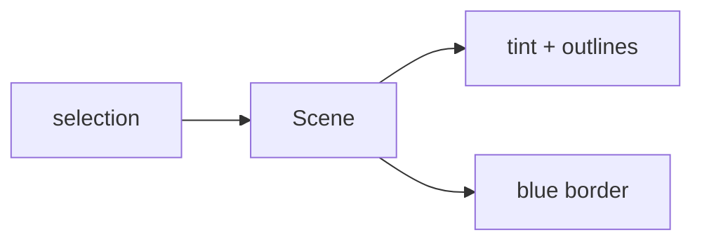

# Handoff: PR-44 / T-071
## Builder notes
### What changed
- **Scene:** optional `selectedRoomId` / `selectedArtworkId`, editor only.
- **Selected room:** blue (`#2563eb`) outlines at floor level and along its wall tops, plus a faint blue floor tint. Done in `Floors`, with the pure helper `selectionOutline`.
- **Selected artwork:** a blue border in `Frames`.
- **Edit page:** passes the store selection.
- **Viewer:** unaffected.
### Diagram

### How to test
```bash
git fetch origin && git switch feat/T-071-3d-selection-highlight && npm ci && npm test && npm run dev
```
1. Open an edit link and switch to 3D.
2. Click a room's floor: Room Properties opens, and the room shows blue outlines (floor and wall tops) and a tinted floor.
3. Click an artwork: Edit Artwork opens, and the frame has a blue border.
## Review rounds
### Round 1
**Verdict:** Approved (05bee1d)
**Blocking issues:** None.
**Non-blocking suggestions:** None. Clean, additive changes: `<Scene>` introduces optional `selectedRoomId` / `selectedArtworkId` props (viewer remains untouched), `Floors` renders faint blue floor tint + dual closed `#2563eb` outline loops (at floor level and wall-top level) with `raycast={noRaycast}`, and `Frames` wraps selected artwork with blue outline.
**What I tested:**
- Checked out PR branch `feat/T-071-3d-selection-highlight` (05bee1d).
- Ran automated test suite: `npm test` passed (362/362 tests passed across 42 files, including 3 new tests in `Floors.test.ts`).
- Static analysis & production build: `npm run typecheck`, `npm run lint`, and `npm run build` compiled cleanly with 0 errors.
- Verified GitHub checks: Vercel preview, CI/ci workflow, and docs-guard are all green.
- Confirmed selection highlight visual mapping and click delegation in builder's headless Chromium check.

## DevOps notes
CI result / merge commit / release note
