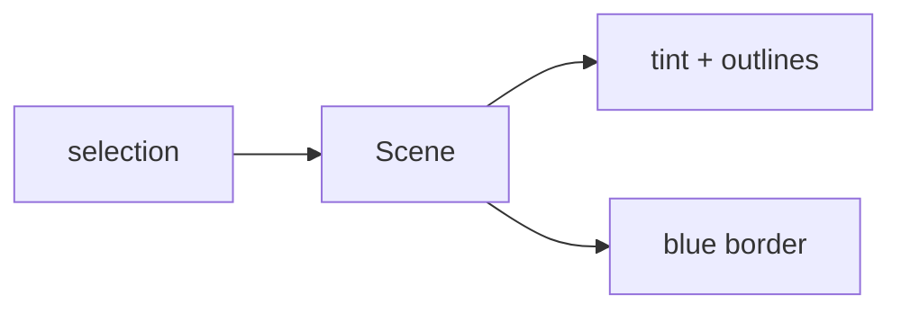

# Handoff: PR-44 / T-071
## Builder notes
### What changed
- **Scene:** optional `selectedRoomId` / `selectedArtworkId`, editor only.
- **Selected room:** blue (`#2563eb`) outlines at floor level and along its wall tops, plus a faint blue floor tint. Done in `Floors`, with the pure helper `selectionOutline`.
- **Selected artwork:** a blue border in `Frames`.
- **Edit page:** passes the store selection.
- **Viewer:** unaffected.
### Diagram

### How to test
```bash
git fetch origin && git switch feat/T-071-3d-selection-highlight && npm ci && npm test && npm run dev
```
1. Open an edit link and switch to 3D.
2. Click a room's floor: Room Properties opens, and the room shows blue outlines (floor and wall tops) and a tinted floor.
3. Click an artwork: Edit Artwork opens, and the frame has a blue border.
## Review rounds
### Round 1
**Verdict** / **Blocking issues** / **Non-blocking suggestions** / **What I tested**
## DevOps notes
CI result / merge commit / release note
