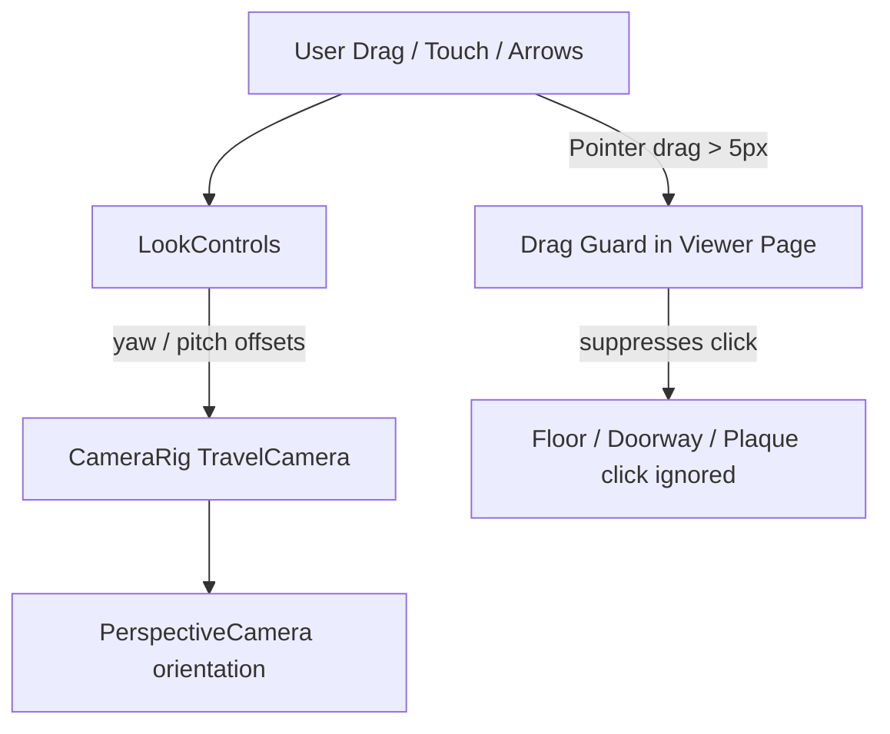

# PR-45 Handoff: Viewer 360° look-around with drag-vs-click guard

- **PR**: https://github.com/PegasusXLab/main/pull/45
- **Task**: T-074
- **Branch**: `feat/T-074-viewer-look-around`
- **Builder**: builder-2
- **Date**: 2026-10-10

## Summary of Changes
- Created `src/viewer3d/LookControls.tsx`:
  - 360° yaw rotation in place and +/-60° pitch clamping (`clampPitch`, `wrapYaw`).
  - Supports mouse drag, one-finger touch drag, and arrow keys.
  - Exposes `isDragMovement` threshold utility (>5 px).
- Integrated into `src/viewer3d/CameraRig.tsx`:
  - `TravelCamera` mounts `LookControls` and applies yaw and pitch rotations to camera forward direction in real time.
  - Smoothly resets look offsets when room or artwork navigation target changes.
  - Does not affect editor's `OrbitControls`.
- Guard in `src/app/g/[id]/page.tsx`:
  - Added pointerdown and pointerup tracking so drags > 5 px set a guard flag suppressing subsequent click events on floors, doorways, and frames.
  - Plain clicks under 5 px continue to navigate rooms and open artwork plaques.
- Unit tests added in `src/viewer3d/LookControls.test.ts`.

## Architecture / Flow

## Testing Performed
- `npm run test -- src/viewer3d/LookControls.test.ts` (3/3 passed)
- Full suite `npm test` (362/362 passed across 42 test files)
- `npm run lint` and `npm run typecheck` passed
- `npm run format:check` 100% clean
