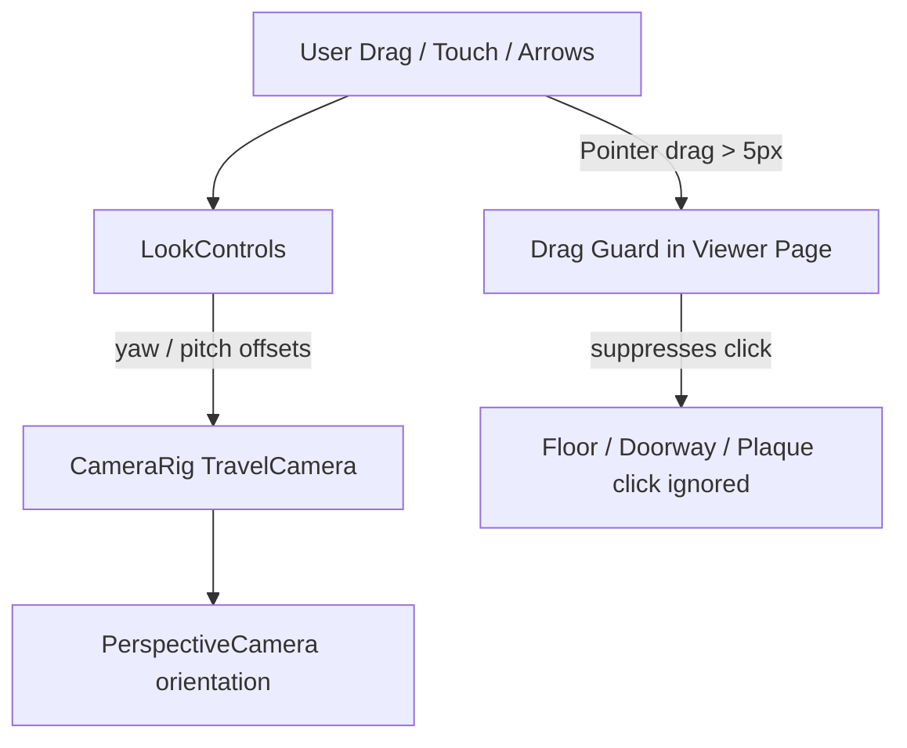

# PR-45 Handoff: Viewer 360° look-around with drag-vs-click guard

- **PR**: https://github.com/PegasusXLab/main/pull/45
- **Task**: T-074
- **Branch**: `feat/T-074-viewer-look-around`
- **Builder**: builder-2
- **Date**: 2026-10-10

## Summary of Changes
- Created `src/viewer3d/LookControls.tsx`:
  - 360° yaw rotation in place and +/-60° pitch clamping (`clampPitch`, `wrapYaw`).
  - Supports mouse drag, one-finger touch drag, and arrow keys.
  - Exposes `isDragMovement` threshold utility (>5 px).
- Integrated into `src/viewer3d/CameraRig.tsx`:
  - `TravelCamera` mounts `LookControls` and applies yaw and pitch rotations to camera forward direction in real time.
  - Smoothly resets look offsets when room or artwork navigation target changes.
  - Does not affect editor's `OrbitControls`.
- Guard in `src/app/g/[id]/page.tsx`:
  - Added pointerdown and pointerup tracking so drags > 5 px set a guard flag suppressing subsequent click events on floors, doorways, and frames.
  - Plain clicks under 5 px continue to navigate rooms and open artwork plaques.
- Unit tests added in `src/viewer3d/LookControls.test.ts`.

## Architecture / Flow

## Testing Performed
- `npm run test -- src/viewer3d/LookControls.test.ts` (3/3 passed)
- Full suite `npm test` (362/362 passed across 42 test files)
- `npm run lint` and `npm run typecheck` passed
- `npm run format:check` 100% clean

### Round 1 (reviewer, 2026-10-10): CHANGES REQUESTED

**Verdict: CHANGES REQUESTED** (1 blocking issue, small)

**Blocking issues**
1. **After travelling to another room, the first drag jumps the view back to the old look angle.** `CameraRig.tsx` resets `yawOffset`/`pitchOffset` to 0 when the target changes (the new `useEffect`). But `LookControls.tsx` keeps its **own** `yaw`/`pitch` refs (lines ~66-67) and never resets them, so the next `applyDelta` reports `oldYaw + tiny delta` and the camera snaps to the old angle.
   Reproduced in Chromium on a locally published sample gallery:
   - Entrance: drag 500 px right (turned about 90°), then **Next room**, which shows East Hall facing its north wall (correct);
   - then a **6 px** drag: the view snaps about 90° sideways (screenshot difference score 15.3, versus 34.7 for a full 400 px drag).

   This breaks "Look offsets reset smoothly to the new target, and dragging … never jumps".
   **Fix (either one):**
   - (a) **Preferred:** make `LookControls` report *deltas* (`onLookDelta(dYaw, dPitch)`) and keep the only yaw/pitch state in `CameraRig`, which already resets it;
   - (b) add a `resetKey` prop (e.g. the current room or focus id) and zero `LookControls`' refs when it changes.

   Add a test: after a target change, a small delta yields a small offset.

**Non-blocking suggestions**
1. **Touch:** `applyDelta` uses `e.movementX ?? …`, but `movementX` is defined (and can be `0`) on some touch browsers, notably iOS Safari, so one-finger look can stall. You already track `startX`/`startY` per move, so use `e.clientX - startX.current` (and the same for y) for the delta. Also make sure the canvas has `touch-action: none` so the page doesn't scroll and fire `pointercancel`.
2. **The reset to the new target is instant,** not eased (the offsets go to 0 in one frame). Easing the offsets to 0 alongside the camera transition would make travel after looking around feel smoother. That's optional for the demo.
3. The arrow keys are global (`window`), so they also fire while typing in any future input on the viewer. Fine today; there are no inputs on `/g`.

**What I tested** (PR head, up to date with main, in a separate worktree; Chromium with SwiftShader WebGL; local storage adapter)
- **Checks:** lint, typecheck, test and format:check clean. `ci`, `docs-guard` and Vercel are green.
- **Setup:** published `sample-3room.json` via `POST /api/galleries` and opened `/g/<id>`.
- **Look-around works within a room:** a 400 px drag rotates the view (diff 34.7), and dragging back returns **exactly** to the start (diff 0).
- **Drag-vs-click works:** a 60 px drag on the floor doesn't travel (the room stays "East Hall"). Plain **Next room** travels.
- **The jump after travel fails** (blocking item 1). Screenshots are kept locally.
- No page errors.
