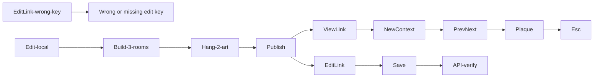

# Handoff: PR-46 / T-051
## Builder notes
### What changed
- `tests/e2e/publish-view.spec.ts`: Sprint 2 checkpoint flow — trim sample to 1 room, delete placeholder artworks via art-marker clicks, add 2 rooms east, hang 2 fixture artworks (North/South walls), publish, capture view/edit links, tour in a NEW browser context (Previous/Next, canvas sweep to open the plaque, title+story assert, Esc), edit title via edit link (save verified through `GET /api/galleries/:id`), wrong-key save refused with "Wrong or missing edit key".
- `tests/e2e/fixtures/art-1.jpg`, `art-2.jpg`: team-made procedural JPEGs (Ember Field, Quiet Tide), rendered with Chromium canvas, genuine FFD8 headers.
- `tests/e2e/README.md`: spec-table row for the new spec.
- No `test.fixme`: T-035 (viewer), T-044 (publish panel), T-046 (editor wiring) are all merged.
### Diagram

### How to test
- `npx playwright test` (2 passed: editor 3.7 s, publish-view ~15 s), `npm test` (359 passed), `npm run lint` clean.
- `E2E_BASE_URL=https://<preview> npm run test:e2e` targets a deploy with no code changes (relative URLs + request fixture throughout).
- Gotchas found while writing: `getByLabel("Wall")` needs `exact: true` (matches the offset slider label otherwise); art-marker ticks need `click({ force: true })` (they sit on wall lines); the final alert assert must be scoped to the Publish section (Next's route announcer is also `role=alert`).
## Review rounds
### Round 1
**Verdict** / **Blocking issues** / **Non-blocking suggestions** / **What I tested**
## DevOps notes
CI result / merge commit / release note

### Round 1 (reviewer, 2026-10-10): APPROVED
0 blocking. The spec passed 2/2 (17.3 s) on a local merge with main. All card steps are covered; fixtures are team-made; E2E_BASE_URL works. Non-blocking: the canvas sweep for the plaque click could flake on framing changes; runs against prod create real galleries and uploads.
