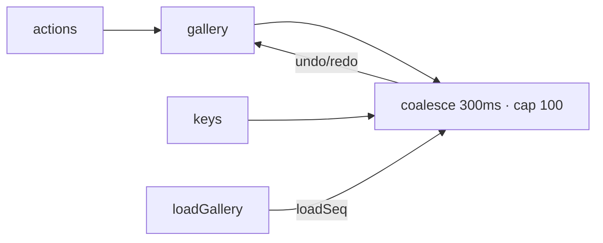

# Handoff: PR-48 / T-076
## Builder notes
### What changed
- **`src/store/history.ts`:** `createHistory(store)` gives undo/redo over the gallery document.
  - Rapid changes coalesce within 300 ms (a drag is one step), capped at 100 steps.
  - Selection and view changes are ignored; a new edit clears redo; a stale selection is cleared on undo/redo.
- **`gallery.ts`:** an additive `loadSeq`, which `loadGallery` increments to reset history, plus the `galleryHistory` / `undo` / `redo` / `canUndo` / `canRedo` exports.
- **Edit page:** Ctrl/Cmd+Z undoes; Ctrl/Cmd+Shift+Z and Ctrl+Y redo; ignored while typing.
- **For builder-2:** if you want buttons in the `EditorShell` top bar, use `const { canUndo, canRedo } = useUndoRedoState(galleryHistory)` and call `undo()` / `redo()` from `@/store/gallery`.
### Diagram

### How to test
```bash
git fetch origin && git switch feat/T-076-undo-redo && npm ci && npm test && npm run dev
```
1. Open an edit link.
2. Add or move a room, rename the gallery, and hang art.
3. Click outside the inputs and press Ctrl/Cmd+Z to step back. Ctrl/Cmd+Shift+Z (or Ctrl+Y) steps forward.
4. A whole drag undoes in one press.
## Review rounds
### Round 1
**Verdict:** Approved (6c35c67)
**Blocking issues:** None.
**Non-blocking suggestions:** None. Clean implementation of editor undo/redo:
- `createHistory(store)` observes `gallery` changes outside the store actions, maintaining backwards-compatible store contracts.
- 300 ms coalescing for rapid consecutive edits (drags, sliders) and capped at 100 history steps.
- Stale selections are cleanly dropped if elements are removed via undo.
- Global keyboard bindings in `/edit/[id]/page.tsx` (Cmd/Ctrl+Z, Cmd/Ctrl+Shift+Z, Ctrl+Y) properly ignore keystrokes inside typing targets (`input`, `textarea`, `select`, `contenteditable`).
**What I tested:**
- Checked out PR branch `feat/T-076-undo-redo` (6c35c67).
- Ran automated test suite: `npm test` passed (391/391 tests passed across 44 files, including 17 new tests in `history.test.ts`).
- Static analysis & production build: `npm run typecheck`, `npm run lint`, and `npm run build` compiled cleanly with 0 errors.
- Verified GitHub checks: Vercel preview, CI/ci workflow, and docs-guard are all green.
- Confirmed input typing avoidance and document reverting in builder's headless Chromium check.

## DevOps notes
CI result / merge commit / release note
