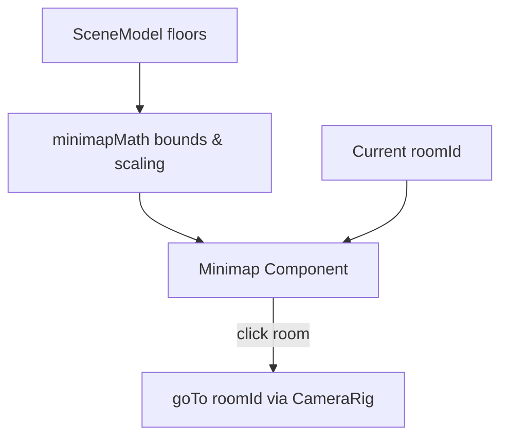

# PR-49 Handoff: Viewer minimap (2D rooms, current room highlighted, click to travel)

- **PR**: https://github.com/PegasusXLab/main/pull/49
- **Task**: T-075
- **Branch**: `feat/T-075-viewer-minimap`
- **Builder**: builder-2
- **Date**: 2026-10-10

## Summary of Changes
- Created `src/viewer3d/minimapMath.ts`:
  - `computeMinimapBounds(floors, padding)`: Computes bounding box across all rooms in plan coordinates.
  - `scaleFloorToMinimap(floor, bounds, width, height)`: Scales world floor coordinates proportionally into target SVG coordinates.
- Created `src/viewer3d/Minimap.tsx`:
  - 2D SVG overlay showing all rooms as rectangles with border/tint.
  - Highlights current room with active blue border/background.
  - Clicking any room calls `onRoomClick(roomId)` to travel there via camera easing.
  - Collapsible (Hide/Show toggle button).
  - Responsive: hidden on small screens (`hidden sm:block`) and non-blocking outside its container (`pointer-events-auto`).
- Mounted in `src/app/g/[id]/page.tsx` as a corner overlay.
- Added unit tests in `src/viewer3d/Minimap.test.tsx`.

## Architecture / Flow

## Testing Performed
- `npm run test -- src/viewer3d/Minimap.test.tsx` (4/4 passed)
- Full test suite: 378/378 passed across 44 test files
- `npm run lint`, `npm run typecheck`, and `npm run format:check` 100% clean
