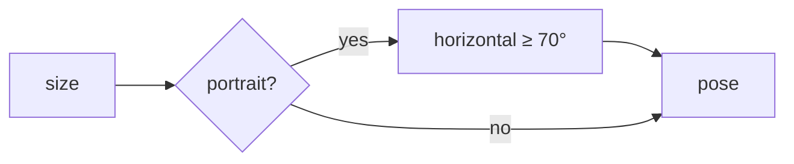

# Handoff: PR-51 / T-081
## Builder notes
### What changed
- **`fovForAspect`** (CameraRig.tsx): portrait canvases raise the vertical fov so the horizontal fov is at least 70° (vertical capped at 120°). Landscape and desktop are unchanged.
- **CameraRig** reads the canvas size, so the fov updates on rotate and resize. Room and artwork-focus poses both use it.
- **No step-back:** the room viewpoint is already 1 m from the wall behind it, so the fov alone fixes the framing.
### Diagram

### How to test
```bash
git fetch origin && git switch feat/T-081-portrait-fov && npm ci && npm test && npm run dev
```
1. Publish a gallery and open `/g/<id>` with devtools set to iPhone 14 or Pixel 7.
2. **Expect:** in the Entrance, the whole far wall is visible, including artwork near its sides.
3. Rotate to landscape: framing is as on desktop.
## Review rounds
### Round 1
**Verdict** / **Blocking issues** / **Non-blocking suggestions** / **What I tested**
## DevOps notes
CI result / merge commit / release note
