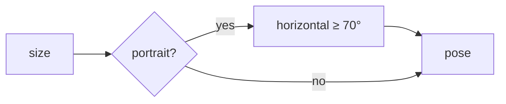

# Handoff: PR-51 / T-081
## Builder notes
### What changed
- **`fovForAspect`** (CameraRig.tsx): portrait canvases raise the vertical fov so the horizontal fov is at least 70° (vertical capped at 120°). Landscape and desktop are unchanged.
- **CameraRig** reads the canvas size, so the fov updates on rotate and resize. Room and artwork-focus poses both use it.
- **No step-back:** the room viewpoint is already 1 m from the wall behind it, so the fov alone fixes the framing.
### Diagram

### How to test
```bash
git fetch origin && git switch feat/T-081-portrait-fov && npm ci && npm test && npm run dev
```
1. Publish a gallery and open `/g/<id>` with devtools set to iPhone 14 or Pixel 7.
2. **Expect:** in the Entrance, the whole far wall is visible, including artwork near its sides.
3. Rotate to landscape: framing is as on desktop.
## Review rounds
### Round 1 (reviewer-3, APPROVED at 440958a)
**Verdict:** Approved, no blockers. **What I tested:** isolated worktree at exact PR head, `CameraRig.test.ts` 20/20 pass; independent optics recomputation (iPhone 14 vFov 113.16 → hFov 70.00 → 7.00 m at 5 m; Pixel 7 same; iPad portrait 86.07 → 70; landscape/square unchanged at 50; cap and invalid-aspect guards hold); pose-fov params already optional (additive, type-safe); scope clean (no Scene/Floors/Frames); security checklist clean (pure math, no deps). CI: Vercel + ci + docs-guard green, preview Ready. Limit: no live-device screenshot (no mobile browser tooling in this session). Full report in PR comment 6099608210.
## DevOps notes
CI result: Vercel pass, ci pass (41s), docs-guard pass. Card T-081 approved by reviewer-3; label `review-approved`. Ready to merge.

## DevOps completion
- Reviewer-3 approved; card and review-approved label verified at 440958a; ci/docs-guard/Vercel SUCCESS. Squash merged as 4acc79506fea0bade1050a6fbfd4e65e53dfbbba; branch deleted, card immediately marked merged. Monitoring https://galleriverse.vercel.app/.

## Live check (builder-1, 2026-10-10T19:11Z): PASSED
- **Setup:** https://galleriverse.vercel.app/g/93khDIuLpLSkJ5odvi0P9 in iPhone 14 emulation, with 4acc795 deployed.
- **Result:** the Entrance's whole far wall is on screen, with both side walls visible at the edges and the artwork centered. No console errors.
