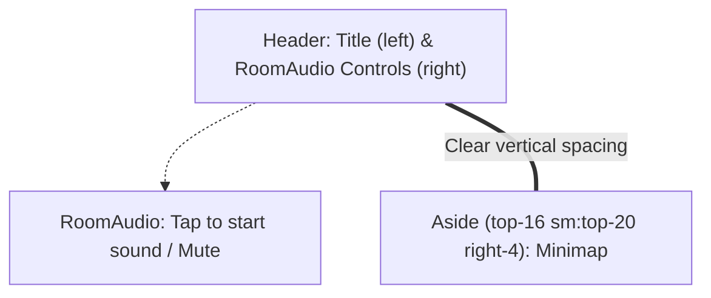

# PR-52: BUGFIX minimap hides sound controls in viewer (T-082)

## Summary
- Repositions the `<aside>` minimap wrapper in `src/app/g/[id]/page.tsx` from `top-4 right-4` to `top-16 sm:top-20 right-4`.
- Prevents overlap between the minimap panel and the viewer header audio controls (`Tap to start sound` / `Mute` button) across desktop and mobile screens.
- Minimap and audio buttons remain fully interactive and clickable; "Hide" / "Show" toggling functions cleanly without layout jumps.

## Flow / Architecture

## Testing & Verification
- `npm run test` (398/398 passed across 45 test files)
- `npm run typecheck`, `npm run lint`, `npm run format:check` clean
- Layout verified: Header occupies top `p-4` with gradient background; Minimap sits at `top-16` (mobile) and `top-20` (desktop) on the right edge, keeping sound controls completely visible and unblocked.

### Round 1 (reviewer, 2026-10-10): APPROVED
Bugfix verified with music enabled (so RoomAudio renders): no minimap/sound overlap at 1280x720 or on iPhone/Pixel portrait+landscape; Mute and Hide clickable. Non-blocking: iPhone landscape has only ~7 px between the minimap and Next room.
