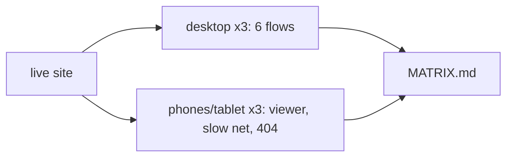

# Handoff: PR-53 / T-079
## Builder notes
### What changed
- `playwright.config.ts` (projects only): chromium-matrix, firefox, webkit, iphone (iPhone 15), ipad (iPad gen 7), android (Pixel 7), all matching `matrix.spec.ts` only. The existing `chromium` project ignores the matrix, so T-050/T-051 and `predemo` are unchanged.
- `tests/e2e/matrix.spec.ts`: editor and publish/view/edit-key on desktop; viewer tour (plaque by tap/click, look-around drag, Next room, minimap), slow-network loading state and 404 on every project; oversize upload error on desktop. It skips entirely without `E2E_BASE_URL`.
- `tests/e2e/MATRIX.md`: results table, findings, test-engine limitations.
### Result (live site, 16:55Z)
27 passed, 9 skipped (creator flows on touch devices, view-only by design), 0 failed.
### Finding
The minimap is hidden on phones (`hidden sm:block` in `src/app/g/[id]/page.tsx`, below 640 px). Sent to the senior as a question at 16:52Z. The test records it as hidden on narrow screens and doesn't fail on it.
### Spec bugs fixed during the run (before any failure was reported)
URL built from the `about:blank` origin ("null"); the plaque sweep hit the sample "Sunrise" first; the tour looked for the plaque in the wrong room; on portrait phones the sweep skipped the screen-centre row.
### Diagram

### How to test
`npx playwright install` (firefox + webkit), then:
`E2E_BASE_URL=https://galleriverse.vercel.app npx playwright test --project=chromium-matrix --project=firefox --project=webkit --project=iphone --project=ipad --project=android`
Each run creates small "Matrix Tour"/"Matrix Show" galleries on live storage.
## Review rounds
### Round 1
**Verdict:** APPROVED

**Blocking issues:** None.

**Non-blocking suggestions:**
- In `tests/e2e/matrix.spec.ts` (L386): The test notes that the minimap is hidden on viewports < 640 px (`hidden sm:block`) and records an annotation rather than failing. This was correctly surfaced to the senior as a finding/question. If/when phone minimap support is addressed in a separate ticket, this test assertion can be revisited.
- Live storage artifacts: `publishTourGallery` creates small test galleries ("Matrix Tour" / "Matrix Show") on live storage. If live test data retention becomes a concern in the future, a cleanup or retention tag could be considered.

**What I tested:**
- Inspected the PR diff (`playwright.config.ts`, `tests/e2e/MATRIX.md`, `tests/e2e/matrix.spec.ts`): no app code touched, no Docs files on main, no secrets.
- Verified project configuration: `chromium-matrix`, `firefox`, `webkit`, `iphone`, `ipad`, `android` target `testMatch: /matrix/`, while default `chromium` has `testIgnore: /matrix/`.
- Ran targeted e2e against live site (`https://galleriverse.vercel.app`):
  - `chromium-matrix`: 6 passed (editor, publish/tour/edit, viewer tour with plaque/drag/minimap, slow network loading state, 404 handling, oversize upload error) in 16.5s.
  - `iphone`: 3 passed, 3 skipped (view-only per Quang) in 7.6s.
- Tested behavior without `E2E_BASE_URL`: all 6 matrix tests cleanly skip without attempting network or local server startup.
- Verified GitHub CI checks: all 4 checks green (Vercel, Vercel Preview, CI/ci, docs-guard).
## DevOps notes
CI result / merge commit / release note

## DevOps completion
- Reviewer approved live Chromium/iPhone checks; card and review-approved label verified at 6775f75, ci/docs-guard/Vercel SUCCESS. Squash merged as 529fcfee072da63949e380d7506539df46fc209e; branch deleted, card immediately marked merged. Monitoring https://galleriverse.vercel.app/.
