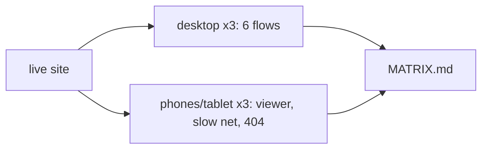

# Handoff: PR-53 / T-079
## Builder notes
### What changed
- `playwright.config.ts` (projects only): chromium-matrix, firefox, webkit, iphone (iPhone 15), ipad (iPad gen 7), android (Pixel 7), all matching `matrix.spec.ts` only. The existing `chromium` project ignores the matrix, so T-050/T-051 and `predemo` are unchanged.
- `tests/e2e/matrix.spec.ts`: editor and publish/view/edit-key on desktop; viewer tour (plaque by tap/click, look-around drag, Next room, minimap), slow-network loading state and 404 on every project; oversize upload error on desktop. It skips entirely without `E2E_BASE_URL`.
- `tests/e2e/MATRIX.md`: results table, findings, test-engine limitations.
### Result (live site, 16:55Z)
27 passed, 9 skipped (creator flows on touch devices, view-only by design), 0 failed.
### Finding
The minimap is hidden on phones (`hidden sm:block` in `src/app/g/[id]/page.tsx`, below 640 px). Sent to the senior as a question at 16:52Z. The test records it as hidden on narrow screens and doesn't fail on it.
### Spec bugs fixed during the run (before any failure was reported)
URL built from the `about:blank` origin ("null"); the plaque sweep hit the sample "Sunrise" first; the tour looked for the plaque in the wrong room; on portrait phones the sweep skipped the screen-centre row.
### Diagram

### How to test
`npx playwright install` (firefox + webkit), then:
`E2E_BASE_URL=https://galleriverse.vercel.app npx playwright test --project=chromium-matrix --project=firefox --project=webkit --project=iphone --project=ipad --project=android`
Each run creates small "Matrix Tour"/"Matrix Show" galleries on live storage.
## Review rounds
### Round 1
**Verdict** / **Blocking issues** / **Non-blocking suggestions** / **What I tested**
## DevOps notes
CI result / merge commit / release note
