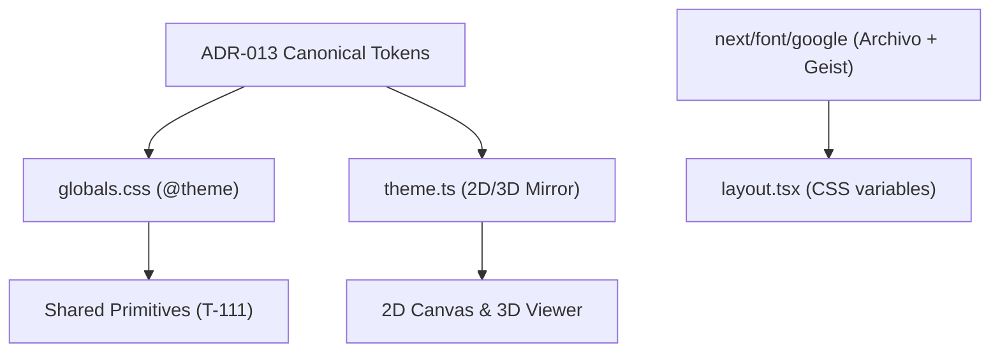

# Handoff: PR-55 / T-110
## Builder notes
### What changed
- **`src/app/globals.css`**: Configured `@theme` with canonical ADR-013 tokens (plaster `#eff0ee`, paper `#ffffff`, graphite `#1e2022`, pencil `#7d8085`, hairline `#d5d7d4`, Klein blue accent `#002fa7`, danger `#c7353f`, kraft `#c59a6a`, 2px radius, motion durations). Removed `@media (prefers-color-scheme: dark)` root invert that previously broke editor panels in dark mode. Added focus-visible outline and reduced-motion fallback.
- **`src/app/layout.tsx`**: Loaded `Archivo` (variable width display font) and `Geist` (sans UI font with tabular figures) via `next/font/google` CSS variables `--font-display` and `--font-sans`.
- **`src/lib/theme.ts`**: Created strongly typed theme token mirror for Three.js 3D renderer and SVG 2D plan.
- **`src/lib/theme.test.ts`**: Added unit tests verifying token values, radius constraints, and motion exports.

### Diagram


### How to test
```bash
git fetch origin && git switch feat/T-110-design-tokens-fonts-theme && npm test && npm run build
```
1. Verify `npm test` passes (46 test files, 408 tests).
2. Verify `npm run typecheck` and `npm run lint` pass cleanly.
3. Verify `@theme` utilities and `THEME` exports match spec acceptance criteria.

## Review rounds


### Review: Round 1 (reviewer-2)
- Verdict: **approved**
- Scope: surgical, only `src/app/globals.css`, `src/app/layout.tsx`, `src/lib/theme.ts`, `src/lib/theme.test.ts`. Zero unrelated file touches.
- ADR-013 Tokens: Canonical Klein blue `#002fa7`, plaster `#eff0ee`, paper `#ffffff`, graphite `#1e2022`, pencil `#7d8085`, hairline `#d5d7d4`, danger `#c7353f`, kraft `#c59a6a`, and 2px border radius.
- Fonts: `Archivo` and `Geist` imported cleanly through `next/font/google` CSS variables.
- Verification: Lint clean, TypeScript typecheck clean, 46/46 test files passed (408/408 tests green). Vercel preview deployment ready, GitHub CI workflows all passing.
