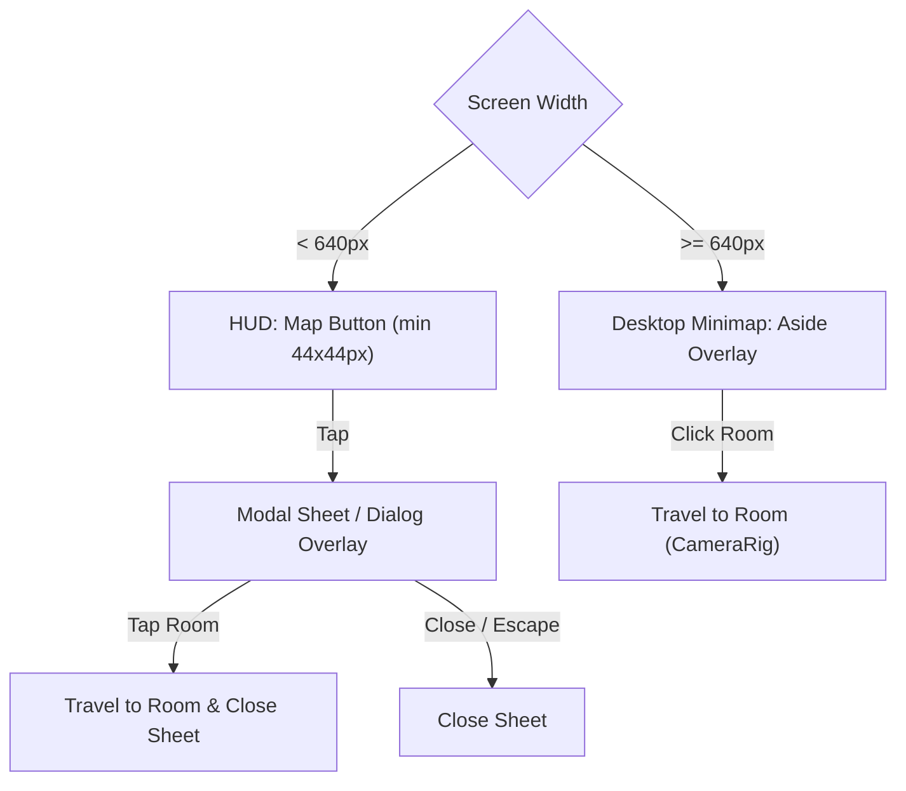

# PR-56: Viewer on phones - tap-to-open map (T-083)

## Summary
- Below 640 px, renders a touch-friendly "Map" button (`min 44x44 px`, `data-testid="minimap-toggle"`, `aria-label="Show map"`) in the viewer HUD.
- Tapping opens the floor plan minimap in a modal sheet / overlay with full backdrop blur.
- Tapping any room navigates to it and closes the overlay; overlay also closes via `✕` button, outside backdrop tap, or `Escape` key.
- At 640 px and up, preserves existing desktop minimap layout, behavior, and testids.
- Updates active room border / highlight to canonical Klein blue (`#002fa7`).

## Architecture / Layout

## Testing & Verification
- Unit tests: `npm run test -- src/viewer3d/Minimap.test.tsx` (4/4 passed).
- Test suite: 404/404 passed across 45 test files.
- `npm run typecheck`, `npm run lint`, and `npm run format:check` 100% clean.

## Review rounds
### Round 1 (reviewer-3, APPROVED at 683bfa44)
0 blockers; 2 non-blocking polish notes (plaque-corner cosmetic overlap under the 44 px toggle; no focus trap in sheet). Verified at exact head in an isolated worktree with fresh npm ci (4/4 pass); THEME.colors.accent confirmed #002fa7; HUD overlap analysis clear (mute/Prev-Next/plaque controls uncovered); desktop markup byte-identical; CI green (Vercel, ci, docs-guard). Limits: no live-device tap test, no T-079 e2e re-run (PROD writes). Full report in PR comment 6100444688; devops notified; card approved.

## DevOps completion
- Approved card and review-approved label verified; ci/docs-guard/Vercel SUCCESS. Squash merged as cd59a8394827d750780afa5c0f4183feee90a9be; branch deleted, card immediately marked merged. Monitoring https://galleriverse.vercel.app/.
