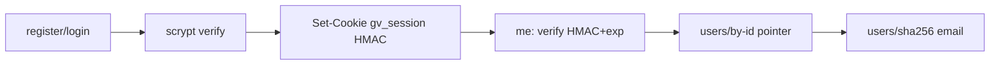

# Handoff: PR-57 / T-100
## Builder notes
### What changed
Accounts backend (ADR-014), Node `crypto` only:
- `src/lib/auth/password.ts`: scrypt + random salt (reuses the T-031 edit-key helper); unknown emails verify against a dummy hash, for timing parity.
- `src/lib/auth/session.ts`: `gv_session` = base64url({userId, exp}).HMAC-SHA256, `timingSafeEqual`, 7-day expiry. Cookie: HttpOnly, SameSite=Lax, Path=/, Max-Age=604800, Secure in production. `AUTH_SECRET` missing: dev fallback in development, 503 in production.
- `src/lib/auth/users.ts`: private `users/<sha256(email)>.json` plus a private `users/by-id/<id>.json` pointer.
- `src/lib/auth/http.ts`: 10 KB body cap, 503 gate, cookie setter, login limiter (10/min per email + IP, per instance).
- Routes: `src/app/api/auth/{register,login,logout,me}/route.ts`.
- `/api/files`: denies `users/` (private objects already 404).
- `.env.example`: `AUTH_SECRET=`.
### API contract (T-101 codes against this)
- `POST /api/auth/register {email,password,name?}` → 201 `{id,email,name}` + cookie | 400 | 409 | 503
- `POST /api/auth/login {email,password}` → 200 `{id,email,name}` + cookie | 401 "Email or password is incorrect" | 429 | 503
- `POST /api/auth/logout` → 200 `{ok:true}`, cookie cleared
- `GET /api/auth/me` → 200 `{id,email,name}` | 401 | 503
- Errors are always `{error: string}`.
### Security review focus
Hashing params (scrypt, 16-byte salt, 64-byte key), cookie flags, the identical 401 and timing parity, the HMAC check, `users/` never public.
### Diagram

### How to test
`npx vitest run src/lib/auth src/app/api/auth` (20 tests). Live: `npm run dev`, then curl register → me (with cookie) → login with a wrong password → logout → me.
🔑 Quang: set `AUTH_SECRET` (32+ random bytes) in Vercel Production + Preview, or the routes answer 503 there.
## Review rounds
### Round 1
**Verdict** / **Blocking issues** / **Non-blocking suggestions** / **What I tested**
## DevOps notes
CI result / merge commit / release note
