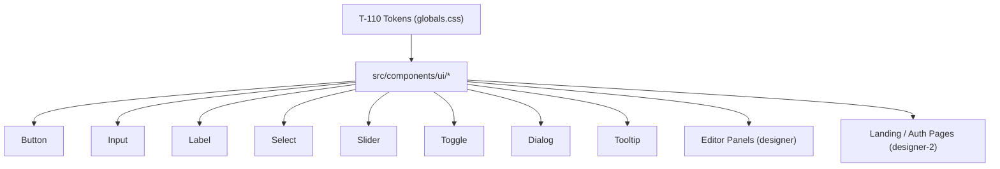

# Handoff: PR-58 / T-111
## Builder notes
### What changed
- Created `src/components/ui/` with 8 accessible primitives on canonical ADR-013 tokens:
  - **Button**: `primary`, `secondary`, `outline`, `ghost`, `destructive` variants; `sm`, `default`, `icon` sizes; 2px radius; active/hover/focus-visible states.
  - **Input**: single line input with `tabular-nums font-mono` support, token borders, focus ring, placeholder styling.
  - **Label**: uppercase tracked label in pencil token.
  - **Select**: custom styled select with chevron indicator and focus ring.
  - **Slider**: range control with accent track and accessible keyboard support.
  - **Toggle**: binary state button with `aria-pressed` and Klein blue active fill.
  - **Dialog**: accessible modal dialog with `graphite/40` backdrop, focus trapping, Escape key listener, and outside click dismiss.
  - **Tooltip**: micro-interaction helper with 120ms fade, supporting both hover and keyboard focus.
- Barrel export in `src/components/ui/index.ts`.
- 8 comprehensive test suites (20 tests) in `src/components/ui/*.test.tsx` testing render, states, and keyboard/mouse interactions.

### Diagram


### How to test
```bash
git fetch origin && git switch feat/T-111-design-ui-primitives && npm test && npm run build
```
1. Verify `npm test` passes (56 test files, 443 tests).
2. Verify `npm run typecheck` and `npm run lint` pass cleanly with zero errors.
3. Verify all 8 primitives export properly from `src/components/ui/index.ts`.

## Review rounds

