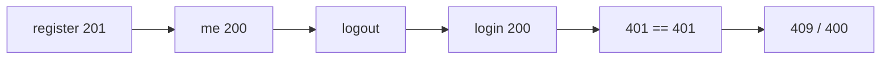

# Handoff: PR-59 / T-115
## Builder notes
### What changed
- `tests/e2e/auth.spec.ts`
  - Accounts API in a fresh request context, with a unique email per run: register 201 + HttpOnly cookie → me → logout → me 401 → login → me. Same 401 body for a wrong password and an unknown email; 409 duplicate; 400 short password.
  - Accounts UI (register from `/`, header shows the user, logout, `/login` deep link): `test.fixme` until T-101. I'll align the selectors with T-101's markup when I enable it.
  - Start-screen regression: New blank gallery → editor; Open edit link → bad-link alert, and a valid link (published via the API) loads the gallery.
- `tests/e2e/README.md`: spec row and how to run it (dedicated port / live URL). `tests/e2e/MATRIX.md`: accounts row.
### Results
- Local (`next dev -p 3200`): 3 pass, 2 skip; `--repeat-each=2`: 6 pass.
- **Live** https://galleriverse.vercel.app (~17:55Z): 3 pass, 2 skip (UI waits for T-101).
### Notes
- The card says register returns 200; the merged T-100 contract returns 201 Created (the test asserts 201).
- `playwright.config.ts` is out of scope: the dedicated port goes through `E2E_BASE_URL`. Adding `auth.spec.ts` to the WebKit/iPhone projects needs a `testMatch` change (devops).
### Diagram

### How to test
`npx next dev -p 3200`, then `E2E_BASE_URL=http://localhost:3200 npx playwright test auth.spec.ts --project=chromium`; or `E2E_BASE_URL=https://galleriverse.vercel.app ...`.
## Review rounds
### Round 1
**Verdict** / **Blocking issues** / **Non-blocking suggestions** / **What I tested**
## DevOps notes
CI result / merge commit / release note
