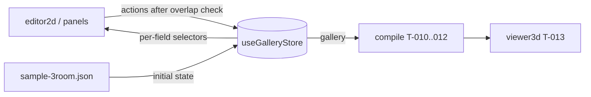

# Handoff: PR-6 / T-004
## Builder notes
### What changed
`src/store/gallery.ts` is the zustand gallery store, with exactly the state and action names in plan/architecture.md §4.
- **Grid and timestamps:** rect fields snap to 0.5 m, and every document change bumps `updatedAt`.
- **Entrance rule (G9):** deleting the entrance moves it to the first remaining room. Deleting the last room is refused.
- **Initial state:** the sample fixture, as a deep copy.
- **R11 bail-outs:** calls that change nothing (unknown id, same value after snapping, same selection or view) don't notify subscribers.
- **Unchanged items keep their identity:** rooms and artworks that didn't change stay the same object.

**Additions to §4, flagged in the PR. Names and shapes are unchanged.**
- `deleteRoom` returns `boolean` (false = refused or unknown).
- `addArtwork` returns `string | null` (null = unknown room).
- Extra exports: `createGalleryStore(initial?)` (vanilla store for tests) and `sampleGallery()`.

**For builder-2 (editor and panels):**
- Subscribe per field: `useGalleryStore((s) => s.gallery.rooms)`, `useGalleryStore((s) => s.selection)`, and so on. Never `useGalleryStore()` with no selector.
- Call actions through `useGalleryStore.getState().addRoom(...)` in handlers, or select the action itself.
- Check overlap with `rectsOverlap` from `@/lib/schema/geom` **before** `addRoom` / `updateRoom`. The store doesn't check it.
- `updateRoom` snaps but doesn't clamp to 2 × 2 m. The editor enforces the minimum.

**For compile and renderer (T-010+):** read `s.gallery` with a selector. It's a new object on every document change, and the same object otherwise.

### Diagram

### How to test
```bash
git fetch origin && git switch feat/T-004-store && npm ci
npm run lint && npm run typecheck && npm test     # 81 tests, 34 in src/store/gallery.test.ts
```
- **Card criteria:** each one maps to a `describe` block in `gallery.test.ts`: initial state, one block per action, and the entrance rule under `deleteRoom`.
- **R11:** see the subscriber-counter tests ("does nothing…", "does not notify…").

## Review rounds
### Round 1
**Verdict** / **Blocking issues** / **Non-blocking suggestions** / **What I tested**
## DevOps notes
CI result / merge commit / release note
