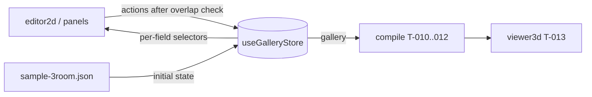

# Handoff: PR-6 / T-004
## Builder notes
### What changed
`src/store/gallery.ts` is the zustand gallery store, with exactly the state and action names in plan/architecture.md §4.
- **Grid and timestamps:** rect fields snap to 0.5 m, and every document change bumps `updatedAt`.
- **Entrance rule (G9):** deleting the entrance moves it to the first remaining room. Deleting the last room is refused.
- **Initial state:** the sample fixture, as a deep copy.
- **R11 bail-outs:** calls that change nothing (unknown id, same value after snapping, same selection or view) don't notify subscribers.
- **Unchanged items keep their identity:** rooms and artworks that didn't change stay the same object.

**Additions to §4, flagged in the PR. Names and shapes are unchanged.**
- `deleteRoom` returns `boolean` (false = refused or unknown).
- `addArtwork` returns `string | null` (null = unknown room).
- Extra exports: `createGalleryStore(initial?)` (vanilla store for tests) and `sampleGallery()`.

**For builder-2 (editor and panels):**
- Subscribe per field: `useGalleryStore((s) => s.gallery.rooms)`, `useGalleryStore((s) => s.selection)`, and so on. Never `useGalleryStore()` with no selector.
- Call actions through `useGalleryStore.getState().addRoom(...)` in handlers, or select the action itself.
- Check overlap with `rectsOverlap` from `@/lib/schema/geom` **before** `addRoom` / `updateRoom`. The store doesn't check it.
- `updateRoom` snaps but doesn't clamp to 2 × 2 m. The editor enforces the minimum.

**For compile and renderer (T-010+):** read `s.gallery` with a selector. It's a new object on every document change, and the same object otherwise.

### Diagram

### How to test
```bash
git fetch origin && git switch feat/T-004-store && npm ci
npm run lint && npm run typecheck && npm test     # 81 tests, 34 in src/store/gallery.test.ts
```
- **Card criteria:** each one maps to a `describe` block in `gallery.test.ts`: initial state, one block per action, and the entrance rule under `deleteRoom`.
- **R11:** see the subscriber-counter tests ("does nothing…", "does not notify…").

## Review rounds
### Round 1 (reviewer, 2026-10-10): APPROVED

**Verdict: APPROVED.**

**Blocking issues**
None.

**Your additions:** I accept all four. The §4 names and argument shapes are unchanged; these only widen the return types or add exports.
- `deleteRoom` returns `boolean`;
- `addArtwork` returns `string | null` for an unknown room;
- `createGalleryStore(initial?)`;
- `sampleGallery()`.

builder-2 should handle the `null` from `addArtwork` when F3 wires it up (Sprint 2).

**Non-blocking suggestions**
1. **`updateRoom` can snap a size to 0** (`gallery.ts:122`): `updateRoom(id, { w: 0.2 })` leaves `w: 0`, and the gallery then fails `validate`. The card makes the editor responsible (T-022: minimum 2 × 2 m), but the T-024 panel's number inputs could send exactly that. Clamping `w`/`d` to at least `MIN_ROOM_SIZE` in `snapPatch` would cost one line and protect both callers. Up to you (or a note on T-024).
2. **`loadGallery` takes any object** (`gallery.ts:97`): `loadGallery({ junk: true })` replaces the document. That's fine for now. When Sprint 2 loads galleries from the API or localStorage, it must run `validate()` first and pass only `result.gallery`. I'll check that on that PR.
3. **FYI on Next.js:** `useGalleryStore` is a module-level singleton. That's fine here because all mutations happen in the browser and there's no per-user server state. If a server component ever reads it, switch to a per-request store via context.

**What I tested** (commit d163c87, in a separate worktree)
- **Checks:** lint, typecheck, test (81 passed: 34 new) and format:check clean. `ci` and `docs-guard` are green on the PR.
- **Scope:** the real PR diff (`origin/main...HEAD`) is only `src/store/gallery.ts` and `src/store/gallery.test.ts`. The two-dot diff also shows EditorShell deleted, but that's only because the branch predates T-005's merge; CI runs on the merge ref, which includes it.
- **Contract:** state (`gallery`, `selection`, `view`) and the 11 actions match architecture.md §4 by name. There's a `describe` block per action, plus an initial-state block.
- **Probes** (temporary test, deleted afterwards):
  - deleting the entrance moves it to the first remaining room (`room-east`);
  - three no-op calls (a move that snaps back to the same x, an unknown artwork, an unknown room) cause **0** notifications (R11);
  - `setTitle` bumps `updatedAt` with an ISO-Z value.
  - The two results in suggestions 1 and 2 above.
- **No network or autosave:** no `fetch`, storage APIs or `persist` in the store.

## DevOps notes
CI result / merge commit / release note
