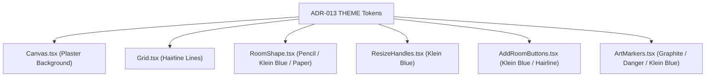

# PR-60: 2D editor adopts design colors (Klein blue accent, plaster grid) (T-112)

## Summary
- Adopts canonical Galleriverse design system tokens (`THEME` from `src/lib/theme.ts`, ADR-013) across `src/editor2d/*`:
  - **Canvas (`Canvas.tsx`)**: Ground styled using `THEME.colors.plaster` (`#eff0ee`).
  - **Grid (`Grid.tsx`)**: Grid subdivision lines rendered with `THEME.colors.hairline` (`#d5d7d4`).
  - **RoomShape (`RoomShape.tsx`)**: Normal room stroke uses `THEME.colors.pencil` (`#7d8085`), selected uses `THEME.colors.accent` (`#002fa7`), drag overlap uses `THEME.colors.danger` (`#c7353f`). Text labels use `THEME.colors.graphite` and `THEME.colors.pencil`.
  - **ResizeHandles (`ResizeHandles.tsx`)**: Handle fills use `THEME.colors.accent` (`#002fa7`).
  - **AddRoomButtons (`AddRoomButtons.tsx`)**: Buttons use `THEME.colors.accent` with `hairline` fallback on overlap.
  - **ArtMarkers (`ArtMarkers.tsx`)**: Markers use `THEME.colors.graphite` default, `THEME.colors.accent` when selected, and `THEME.colors.danger` on compile issues.
  - **Resize Preview (`Canvas.tsx`)**: Uses `THEME.colors.accent` / `THEME.colors.danger`.
- Replaced all raw `#2563eb` and raw hexes across `editor2d`.
- Preserved all element IDs, test IDs, and behaviors.

## Diagram

## Testing & Verification
- `npm run test -- src/editor2d/` (42/42 passed across 8 test files)
- Full test suite: 423/423 passed across 48 test files
- `npm run typecheck`, `npm run lint`, and `npm run format:check` 100% clean
