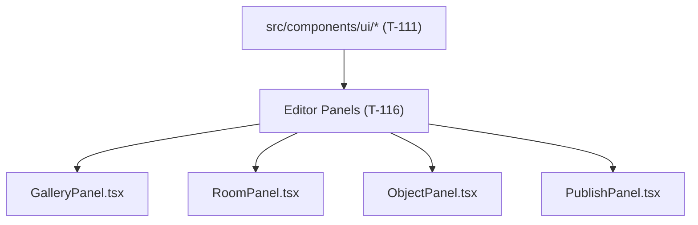

# Handoff: PR-61 / T-116
## Builder notes
### What changed
- Editor sidebar panels refactored to adopt shared UI primitives from `src/components/ui/` and ADR-013 design tokens:
  - **`src/panels/GalleryPanel.tsx`**: uses `Input`, `Label`, `Select` primitives; uppercase pencil labels, hairline dividers, tabular numbers for room counts.
  - **`src/panels/RoomPanel.tsx`**: uses `Input` (with tabular layout for dimensions), `Label`, `Select` (floor, lighting, atmosphere, music), `Slider` (custom mood haze, brightness, light direction, grain), and `Button` (`variant="secondary"` for add object, `variant="destructive"` for delete room).
  - **`src/panels/ObjectPanel.tsx`**: uses `Input` (title, artist, width), `Label`, `Select` (wall), `Slider` (wall offset, center height), and `Button` (`variant="primary"` Klein blue for save/add artwork, `variant="outline"` for cancel, `variant="destructive"` for delete).
  - **`src/components/PublishPanel.tsx`**: uses `Button` (`variant="primary"` for publish/save, `variant="secondary"` for copy), `Input` for read-only links, `Label` for link labels.
  - **Contract Preservation**: Every single existing `id`, `data-testid`, and `aria-label` preserved without alteration across all 4 panels.
  - **`src/panels/RoomPanel.test.tsx`**: updated disabled assertion from checking legacy raw classname string `cursor-not-allowed` to checking `disabled=""` attribute on the delete button.

### Diagram


### How to test
```bash
git fetch origin && git switch feat/T-116-panels-adopt-primitives && npm test && npm run build
```
1. Run `npm test` -> 56/56 test suites pass (443/443 tests).
2. Run `npm run typecheck` -> 0 errors.
3. Run `npm run lint` -> 0 errors.
4. Run `npm run build` -> production build compiles successfully.

## Review rounds

## DevOps completion
- Approved card and review-approved label verified at 4a3155f; ci/docs-guard/Vercel SUCCESS. Squash merged as 5cfc81be93cd68418727af08f7a30b772189d676; branch deleted, card immediately marked merged. Monitoring https://galleriverse.vercel.app/.
