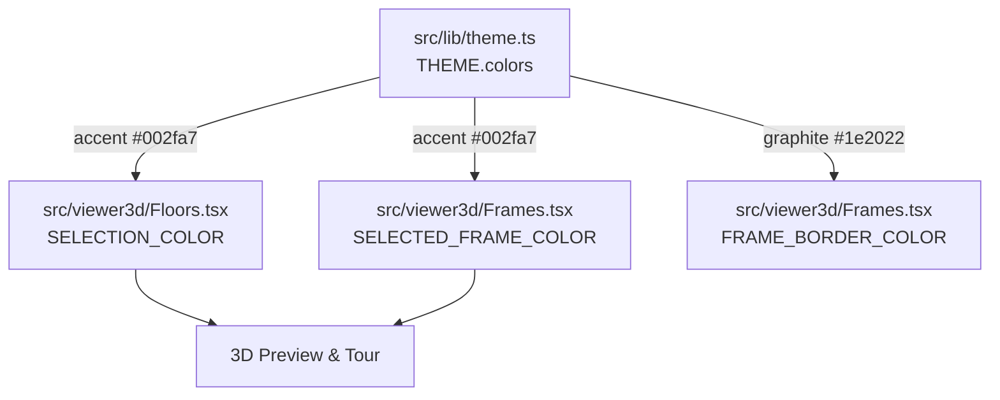

# Handoff: PR-63 / T-114
## Builder notes
### What changed
- `src/viewer3d/Floors.tsx`:
  - Imported `THEME` from `@/lib/theme`.
  - Updated `SELECTION_COLOR` to `THEME.colors.accent` (`#002fa7`, Klein blue per ADR-013).
  - Preserved floor material preset colors (`FLOOR_COLORS` wood/concrete/marble).
- `src/viewer3d/Frames.tsx`:
  - Imported `THEME` from `@/lib/theme`.
  - Updated `FRAME_BORDER_COLOR` to `THEME.colors.graphite` (`#1e2022`).
  - Updated `SELECTED_FRAME_COLOR` to `THEME.colors.accent` (`#002fa7`).
- `src/viewer3d/Floors.test.ts`:
  - Updated assertion verifying `SELECTION_COLOR` and `SELECTED_FRAME_COLOR` equal `THEME.colors.accent` and `#002fa7`.
- `src/viewer3d/Frames.test.tsx`:
  - Updated assertion verifying `FRAME_BORDER_COLOR` equals `THEME.colors.graphite` (`#1e2022`) and `SELECTED_FRAME_COLOR` equals `THEME.colors.accent` (`#002fa7`).
- Moonlit atmosphere visual check:
  - Both room selection and artwork frame selection remain unlit (`MeshBasicMaterial` / `Line`), ensuring clear visibility against dark backgrounds.
  - Screenshots captured and committed to `team/builder-1__vic/sprint-3/`:
    * `T-114-moonlit-selection.png`: Room selection floor and wall top outline under Moonlit.
    * `T-114-moonlit-artwork-selection.png`: Selected artwork frame border under Moonlit.

### Diagram

### How to test
1. Run `npm test` -> all 58 test files pass (468 tests), including `Floors.test.ts` and `Frames.test.tsx`.
2. Run `npm run lint` and `npm run typecheck` -> clean.
3. Run `npm run predemo` -> clean PASS.
4. Open the 3D editor at `/edit/local`, select a room or artwork, switch between atmospheres (especially Moonlit), and observe the Klein blue selection outline.
5. Inspect the Moonlit screenshots in `team/builder-1__vic/sprint-3/`.

## Review rounds
### Round 1
(Pending reviewer-2)

## DevOps completion
- Approved card and review-approved label verified at 734852c; ci/docs-guard/Vercel SUCCESS. Squash merged as 7de0353ca0894d6a3750f28dbe8ee82f225f1567; branch deleted, card immediately marked merged. Monitoring https://galleriverse.vercel.app/.
