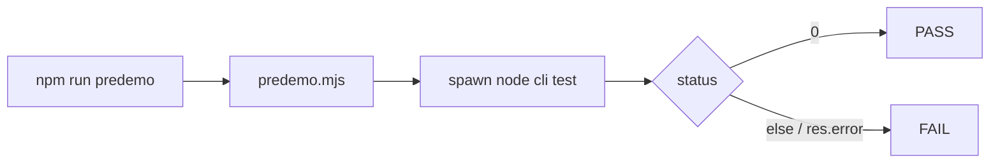

# Handoff: PR-64 / T-118
## Builder notes
### What changed
- `tests/e2e/predemo.mjs` (new): starts Playwright's CLI with `process.execPath` (no `npx.cmd`, no shell), runs `publish-view.spec.ts --project=chromium` against `E2E_BASE_URL` (default https://galleriverse.vercel.app). It prints FAIL + the reason and exits 1 when Playwright is missing or the spawn errors (`res.error`); PASS only when the test ran and passed.
- `package.json`: only the `predemo` line, now `node tests/e2e/predemo.mjs`.
- Deviation: the card suggested `scripts/predemo.mjs`, but docs-guard rejects `scripts/` on main.
### Verified on Windows 11
Before: FAIL with no error (EINVAL swallowed). After: Git Bash PASS (exit 0); PowerShell PASS twice (exit 0); launch failure prints FAIL (Playwright not installed) with exit 1. One PowerShell run hit an intermittent LIVE failure (edit-with-key saved, but the API returned the old title), correctly reported as FAIL; sent to the senior separately.
### Diagram

### How to test
On Windows: `npm run predemo` in Git Bash and in PowerShell; expect `>>> PREDEMO CHECK: PASS <<<`.
## Review rounds
### Round 1
**Verdict:** APPROVED

**Blocking issues:** None.

**Non-blocking suggestions:** None.

**What I tested:**
- Diff inspection: `package.json` script updated cleanly to `node tests/e2e/predemo.mjs`; `tests/e2e/predemo.mjs` directly resolves `@playwright/test/cli` via `createRequire` and spawns via `process.execPath` without shell/cmd dependencies.
- Verified error handling: Checks for missing Playwright module with descriptive error banner; handles `res.error` on spawn failures; correctly checks exit code 0 before logging PASS banner.
- Verified placement in `tests/e2e/` respects `docs-guard` rules against `scripts/` on `main`.
- Verified Playwright CLI resolution locally.
- GitHub CI checks: All 4 checks passing (Vercel, Vercel Preview, CI/ci, docs-guard).
## DevOps notes
CI result / merge commit / release note

