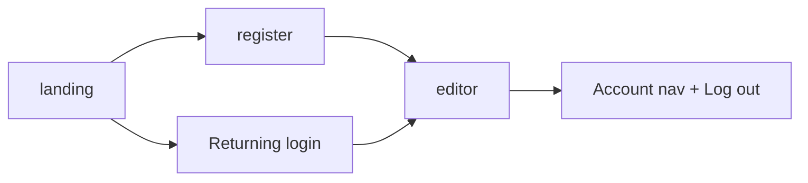

# Handoff: PR-65 / T-117 (finishes the T-115 UI part)
## Builder notes
### What changed
- `tests/e2e/auth.spec.ts`: accounts UI tests enabled against T-101's markup. Register via "New here" → /edit/local → `/` Account nav shows the name + Log out → logout → "Returning" tab; login from "Returning"; `/login` deep link with the generic wrong-password alert. The start-screen bad-link check now uses a URL-shaped non-edit link (the input is type=url since T-101).
- `tests/e2e/MATRIX.md`: a "Live regression runs (T-117)" log; first row 14:25 EDT @ 10b2b8a.
### Results (live, https://galleriverse.vercel.app)
- auth.spec (Chromium): 6/6 pass.
- Matrix (6 projects): 27 pass, 9 skip, 0 fail.
### Findings sent to the senior
- type=url blocks pasting RELATIVE edit links (/edit/<id>?key=…), which is what the Publish panel displays (Copy copies the full URL). Low priority, app fix.
- Earlier, an intermittent live failure (1 of 4 predemo runs): edit-with-key showed "Saved." but the API returned the old title.
### Diagram

### How to test
`E2E_BASE_URL=https://galleriverse.vercel.app npx playwright test auth.spec.ts --project=chromium`
## Review rounds
### Round 1
**Verdict** / **Blocking issues** / **Non-blocking suggestions** / **What I tested**
## DevOps notes
CI result / merge commit / release note
