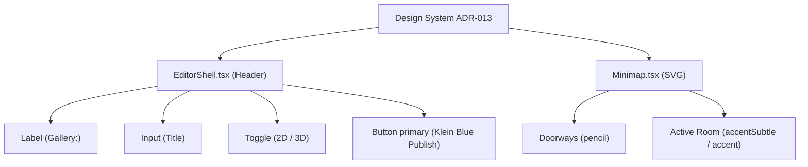

# PR-66: Editor top bar adopts design system + minimap colors (T-120)

## Summary
- **Top Bar (`src/components/EditorShell.tsx`)**:
  - Replaced raw HTML `<label>` with design system `<Label>` primitive (`htmlFor="gallery-title-input"`).
  - Replaced raw `<input>` with `<Input>` primitive (`id="gallery-title-input"`).
  - Replaced ad-hoc 2D/3D mode switch with `<Toggle>` primitives (`pressed={view === "2d"}`, `pressed={view === "3d"}`).
  - Replaced ad-hoc Publish `<button>` with `<Button variant="primary" size="sm">` (Klein blue).
  - Adopted theme background and border tokens (`bg-plaster`, `border-hairline`).
- **Minimap (`src/viewer3d/Minimap.tsx`)**:
  - Replaced amber doorway lines (`#fbbf24`) with `THEME.colors.pencil`.
  - Replaced floor strokes with `THEME.colors.hairline` (inactive) and `THEME.colors.accent` (active).
  - Replaced floor fill with `THEME.colors.accentSubtle` for the current room.
  - Eliminated raw hex codes.
- **Contract & Accessibility**:
  - Preserved all IDs, data-testids, roles, and accessible names (`'Publish'`, `'2D'`, `'3D'`).

## Diagram

## Testing & Verification
- `npm run test` (468/468 unit tests passed)
- `npm run lint` (clean)
- `npm run typecheck` (clean)
- `npm run format:check` (clean)
- `npx playwright test tests/e2e/editor.spec.ts tests/e2e/publish-view.spec.ts` (2/2 passed)

## Review rounds
### Round 1
**Verdict:** APPROVED

**Blocking issues:** None.

**Non-blocking suggestions:** None.

**What I tested:**
- Diff inspection: Verified `src/components/EditorShell.tsx` adopts `Label`, `Input`, `Toggle`, and `Button` (variant primary) from `@/components/ui/*`.
- Verified accessible names, roles, and testids are 100% preserved (`Publish` button, `2D` and `3D` toggle buttons, `gallery-title-input`).
- Verified `src/viewer3d/Minimap.tsx` replaces doorway amber and floor lines with `THEME.colors.pencil`, `THEME.colors.hairline`, and `THEME.colors.accentSubtle` without introducing raw hexes.
- GitHub CI checks: All 4 checks passing (Vercel, Vercel Preview, CI/ci, docs-guard).

