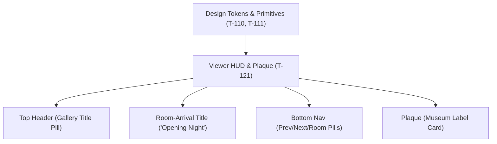

# Handoff: PR-67 / T-121
## Builder notes
### What changed
- **Viewer HUD (`src/app/g/[id]/page.tsx`)**:
  - Restyled header gallery title into a graphite translucent pill with paper text and subtle border.
  - Restyled bottom navigation bar (Previous room, room name pill, Next room) using graphite translucent pills (`bg-graphite/80`), hairline borders, paper text, and Klein blue focus rings.
  - Kept mobile 390px responsive framing intact (no overlap with the minimap toggle at `top-16` / `top-20`).
- **Room-Arrival Title ("Opening Night")**:
  - When visitors enter a room (initial mount, Prev/Next buttons, minimap click, or doorway/floor travel clicks), the room name fades in with Archivo display font (~180ms fade in, holds ~1.5s, ~400ms fade out).
  - Uses `pointer-events: none` and `aria-hidden="true"`, ensuring it never blocks canvas or HUD interactions and avoids double announcements.
  - Respects `prefers-reduced-motion` with `motion-reduce:transition-none`.
- **Artwork Plaque (`src/viewer3d/Plaque.tsx`)**:
  - Styled as an authentic museum wall label on paper card (`bg-paper/95`), hairline border, Archivo typography, with the shared UI `Button` primitive for Close.
  - Preserved `role="dialog"`, `aria-label`, Escape key dismiss, and Close button text.
- **Unit Testing**:
  - Added `src/viewer3d/Plaque.test.tsx` (2 tests) verifying dialog role, accessibility labels, artwork info rendering, and fallbacks.

### Diagram


### How to test
```bash
git fetch origin && git switch feat/T-121-viewer-hud-opening-night && npm test && npm run build
```
1. Run `npm test` -> 59/59 test suites pass (470/470 tests).
2. Run `npm run typecheck` -> 0 errors.
3. Run `npm run lint` -> 0 errors.
4. Run `npm run build` -> production build succeeds.

## Review rounds
### Round 1 (reviewer-3, APPROVED at 7dd63860)
0 blockers; 3 non-blocking polish notes (plaque title missing font-display + no tabular-nums; Tooltip unused though named in AC; unneeded `export default Plaque`). Verified at exact head in an isolated worktree with fresh npm ci (Plaque tests 2/2); all token classes resolve in globals.css/theme.ts; Button primitive preserves the Close accessible name; arrival timings/motion/pointer/aria verified; accessible names + testids byte-identical; plaque z-20 resolves the T-083 toggle overlap; scope exact; CI green (Vercel, ci, docs-guard). Limits: no live-device run, no e2e re-run (PROD writes). Full report in PR comment 6101060235; devops notified; card approved.

## DevOps completion
- Approved card and review-approved label verified; ci/docs-guard/Vercel SUCCESS. Squash merged as b29284b33f1ba715d1ea07464d8603e8cc4ad728; branch deleted, card immediately marked merged. Monitoring https://galleriverse.vercel.app/.
