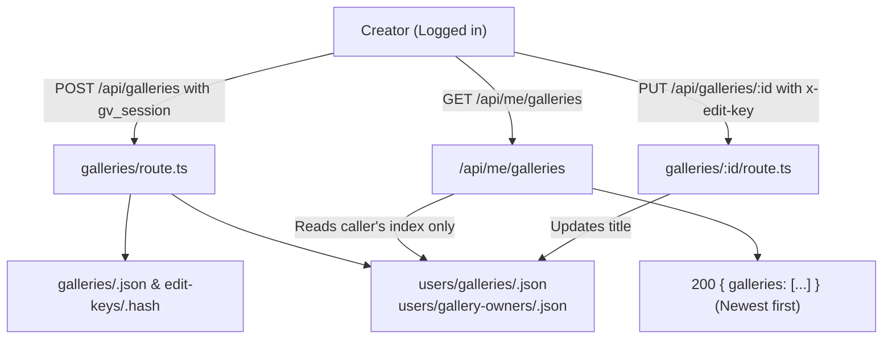

# Handoff: PR-68 / T-102
## Builder notes
### What changed
- `src/lib/auth/ownership.ts`:
  - Created private ownership helper module storing user gallery lists under `users/galleries/<userId>.json` and reverse pointer `users/gallery-owners/<galleryId>.json`.
  - Stored under `users/`, which `/api/files` already refuses to serve (404).
  - Implemented `recordGalleryOwner`: Appends `{ id, title, createdAt, editUrl, viewUrl }` to the creator's index.
  - Implemented `updateGalleryTitleInIndex`: Updates the gallery title in the owner index on save.
  - Implemented `listUserGalleries`: Reads caller's gallery index and returns entries sorted newest first.
  - Implemented `getSessionUserId`: Verifies caller's session from `gv_session` cookie.
- `src/app/api/me/galleries/route.ts`:
  - Created `GET /api/me/galleries`: Authenticates caller via HMAC session cookie, retrieves their private gallery list sorted newest first, and returns 200 `{ galleries: [...] }`. Returns 401 when logged out or unauthenticated.
- `src/app/api/galleries/route.ts`:
  - Hooked `recordGalleryOwner` into `POST` when session is present. Failures to write the index are caught and logged, never failing the publish. Anonymous publish remains unchanged.
- `src/app/api/galleries/[id]/route.ts`:
  - Hooked `updateGalleryTitleInIndex` into `PUT`. Gallery schema remains untouched and edit-key verification is preserved.
- Unit and Route tests:
  - `src/lib/auth/ownership.test.ts`: 5 tests covering recording, newest-first sorting, user isolation, and title updates.
  - `src/app/api/me/galleries/route.test.ts`: 4 tests covering 401 on unauthenticated, 401 on bad token, 200 empty list, and 200 sorted list with isolation.
  - `src/app/api/galleries/route.test.ts`: Added tests verifying ownership recording on logged-in publish, title updating on PUT, and omitted on anonymous publish.

### Diagram

### How to test
1. Run `npm test`: 60/60 test files pass (479 tests).
2. Run `npm run lint` and `npm run typecheck`: clean.
3. Run `npm run test:e2e tests/e2e/auth.spec.ts tests/e2e/publish-view.spec.ts`: 7/7 tests pass.
4. Run `npm run predemo`: clean PASS.

## Review rounds
### Round 1
Approved by reviewer-2 (Parth) without changes:
- Authorization and user isolation verified on GET /api/me/galleries with HMAC session token.
- Storage privacy under users/ protected from /api/files download.
- Graceful degradation verified (index failure does not fail publish/edit).
- Anonymous publishing unchanged.
- All 60 test suites (479 tests), e2e suites, and predemo passed clean.

Merged into main as commit f33208a by devops.

## DevOps completion
- Approved card and review-approved label verified; ci/docs-guard/Vercel SUCCESS. Squash merged as f33208afa65c8789ce19c239f7004eca7ad0483c; branch deleted, card immediately marked merged. Monitoring https://galleriverse.vercel.app/.
