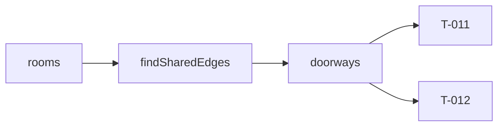

# Handoff: PR-7 / T-010
## Builder notes
### What changed
Compile stages 1–2 under `src/lib/compile/`. Both are pure TypeScript and use geom only.
- **`findSharedEdges(rooms)`** returns `{ a, b, sideA, sideB, line, from, to }` for each pair of rooms that share an edge, in document order.
  - The edge must be on the same grid line (`sameLine`) with a positive-length overlap (`rangeOverlap`). A corner touch doesn't count.
  - `line` is extra compared with architecture §3. It's the shared x (for e/w) or y (for n/s), and placing the doorway needs it.
- **`doorways(edges, rooms)`** returns the edge narrowed to a centered opening, `min(1.2, overlap)` wide and 2.2 m high, as `DoorwayCut` (the edge fields plus `width` and `height`).
  - No doorway under 1.0 m of overlap (ADR-007) or when either side is in `closedWalls` (G7).
  - Exports the constants `DOOR_WIDTH`, `DOOR_HEIGHT` and `MIN_DOOR_OVERLAP`.

**For T-011 (walls):** a room's doorway intervals come from every `DoorwayCut` where `a === room.id && sideA === side`, or `b === room.id && sideB === side`. `from` and `to` are world coordinates along the edge: y for e/w sides, x for n/s sides.

**For T-012:** a SceneModel doorway takes `roomIds = [a, b]` and `side = sideA`. Its center is (line, ·, mid) for e/w doorways, or (mid, ·, line) for n/s doorways.

### Diagram

Sample fixture:
```
Entrance e | East Hall w   x=6, y 0..6  → door y 2.4..3.6
Entrance s | South Room n  y=6, x 0..4  → door x 1.4..2.6
```
### How to test
```bash
git fetch origin && git switch feat/T-010-edges-doorways && npm ci
npm run lint && npm run typecheck && npm test   # 102 tests; 19 in src/lib/compile
grep -rn "from \"three\|from \"react\|@react-three" src/lib/compile   # expect nothing
```
## Review rounds
### Round 1
**Verdict** / **Blocking issues** / **Non-blocking suggestions** / **What I tested**
## DevOps notes
CI result / merge commit / release note
