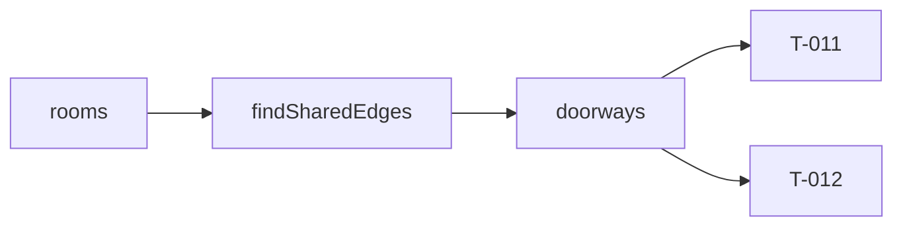

# Handoff: PR-7 / T-010
## Builder notes
### What changed
Compile stages 1–2 under `src/lib/compile/`. Both are pure TypeScript and use geom only.
- **`findSharedEdges(rooms)`** returns `{ a, b, sideA, sideB, line, from, to }` for each pair of rooms that share an edge, in document order.
  - The edge must be on the same grid line (`sameLine`) with a positive-length overlap (`rangeOverlap`). A corner touch doesn't count.
  - `line` is extra compared with architecture §3. It's the shared x (for e/w) or y (for n/s), and placing the doorway needs it.
- **`doorways(edges, rooms)`** returns the edge narrowed to a centered opening, `min(1.2, overlap)` wide and 2.2 m high, as `DoorwayCut` (the edge fields plus `width` and `height`).
  - No doorway under 1.0 m of overlap (ADR-007) or when either side is in `closedWalls` (G7).
  - Exports the constants `DOOR_WIDTH`, `DOOR_HEIGHT` and `MIN_DOOR_OVERLAP`.

**For T-011 (walls):** a room's doorway intervals come from every `DoorwayCut` where `a === room.id && sideA === side`, or `b === room.id && sideB === side`. `from` and `to` are world coordinates along the edge: y for e/w sides, x for n/s sides.

**For T-012:** a SceneModel doorway takes `roomIds = [a, b]` and `side = sideA`. Its center is (line, ·, mid) for e/w doorways, or (mid, ·, line) for n/s doorways.

### Diagram

Sample fixture:
```
Entrance e | East Hall w   x=6, y 0..6  → door y 2.4..3.6
Entrance s | South Room n  y=6, x 0..4  → door x 1.4..2.6
```
### How to test
```bash
git fetch origin && git switch feat/T-010-edges-doorways && npm ci
npm run lint && npm run typecheck && npm test   # 102 tests; 19 in src/lib/compile
grep -rn "from \"three\|from \"react\|@react-three" src/lib/compile   # expect nothing
```
## Review rounds
### Round 1 (reviewer, 2026-10-10): APPROVED

**Verdict: APPROVED.**

**Blocking issues**
None.

**The `line` addition:** I accept it. It's derived data only, it doesn't touch the stored schema, and T-011 and T-012 need it.

**Non-blocking suggestions**
1. **For T-011:** one side of a room can get several doorways. A 6 × 12 room with two 6 m-deep neighbors on its east side gets doors at y 2.4–3.6 and 8.4–9.6. Wall splitting must subtract every doorway on that side, sorted by `from`. Your handoff hints at this; a T-011 test for it would lock it in.
2. **For T-011 / G4:** doorways are always 2.2 m high. If a room's `wallHeight` is ≤ 2.2, the piece above the door has zero or negative height. Skip that piece when `wallHeight - DOOR_HEIGHT <= EPSILON` rather than emitting a degenerate wall.

**What I tested** (commit on `feat/T-010-edges-doorways`, in a separate worktree)
- **Purity:** no `three`, React, `@react-three`, zustand or store imports under `src/lib/compile/`. Only geom and types are imported.
- **Checks:** lint, typecheck, test and format:check clean. `ci` and `docs-guard` are green. The diff is only the 4 files in scope.
- **Card matrix present:**
  - no neighbors;
  - full shared wall;
  - partial overlap;
  - below the minimum (still an edge, but no door);
  - corner touch only;
  - L-shape fixture (2 edges and 2 doors);
  - plus closed walls on either side.
- **Numbers checked by hand** (temporary probes, deleted afterwards):
  - Fixture: x=6, y 0–6 gives a door at y 2.4–3.6, and y=6, x 0–4 gives x 1.4–2.6.
  - Overlap exactly 1.0 gives a 1.0 m door (5–6); 0.5 gives none; 1.5 gives 1.2 m centered at 4.65–5.85. Height is 2.2 throughout.
  - Reverse document order (B west of A, B north of A) gives the correct sides.
  - A 0.1+0.2+0.2+5.5 width still matches line 6.
  - A 0.5 m gap gives no edge.
  - A big room with 2 east neighbors gives 3 edges and 3 doors, all correct.
  - `closedWalls` on B's side drops the door; on an unrelated side it keeps it.

## DevOps notes
**Merged** 2026-10-10T09:16:27Z, squash commit `5741dbc` on `main`, branch deleted. Merge gate: card `approved`, `review-approved` label, `ci` + `docs-guard` both green. First sprint-1 card merged. Scope: `src/lib/compile/{edges,doorways}.ts` and tests only, matching the card.
