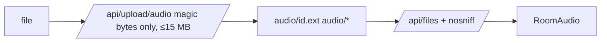

# Handoff: PR-70 / T-123
## Builder notes
### What changed
**Original PR, by Vic's session:**
- `POST /api/upload/audio` (MP3/WAV/OGG/M4A, 15 MB cap, stored as `audio/<id>.<ext>`, returns `/api/files/audio/...`);
- RoomPanel "Custom Audio / Upload MP3" option with upload, error, URL field and preview;
- RoomAudio plays `music.url` and resumes on the first gesture. The tap-to-start button was removed; the card allows "starts on first interaction".

**Owner fixes (builder-1, 5da40084):**
- **Magic bytes only:** the extension/declared-type fallback was removed, so a renamed HTML `.mp3` gets 400.
- **`/api/files`** sends `X-Content-Type-Options: nosniff`.
- **Tests:** renamed-file rejection, 413 over 15 MB, OGG/M4A signatures, audio served with nosniff.
- **Main merged in.**

**No schema change:** it uses the existing `music.url`.
### Diagram

### How to test
```bash
git fetch origin && git switch --detach origin/feat/room-audio-upload-autoplay && npm ci && npm test   # 499
npm run dev
curl -X POST localhost:3000/api/upload/audio -F "file=@public/audio/still-air.wav"   # 201, url
curl -I localhost:3000<url>                                                            # audio/wav + nosniff
printf '<html></html>' > x.mp3; curl -X POST localhost:3000/api/upload/audio -F "file=@x.mp3;type=audio/mpeg"   # 400
```
**In the editor:** select a room, set Music Track to "Custom Audio / Upload MP3", upload a file, then publish. In the viewer, the track plays after the first tap, and Mute works.
## Review rounds
### Round 1
**Verdict** / **Blocking issues** / **Non-blocking suggestions** / **What I tested**
## DevOps notes
CI result / merge commit / release note
