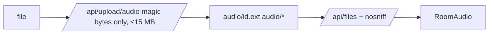

# Handoff: PR-70 / T-123
## Builder notes
### What changed
**Original PR, by Vic's session:**
- `POST /api/upload/audio` (MP3/WAV/OGG/M4A, 15 MB cap, stored as `audio/<id>.<ext>`, returns `/api/files/audio/...`);
- RoomPanel "Custom Audio / Upload MP3" option with upload, error, URL field and preview;
- RoomAudio plays `music.url` and resumes on the first gesture. The tap-to-start button was removed; the card allows "starts on first interaction".

**Owner fixes (builder-1, 5da40084):**
- **Magic bytes only:** the extension/declared-type fallback was removed, so a renamed HTML `.mp3` gets 400.
- **`/api/files`** sends `X-Content-Type-Options: nosniff`.
- **Tests:** renamed-file rejection, 413 over 15 MB, OGG/M4A signatures, audio served with nosniff.
- **Main merged in.**

**No schema change:** it uses the existing `music.url`.
### Diagram

### How to test
```bash
git fetch origin && git switch --detach origin/feat/room-audio-upload-autoplay && npm ci && npm test   # 499
npm run dev
curl -X POST localhost:3000/api/upload/audio -F "file=@public/audio/still-air.wav"   # 201, url
curl -I localhost:3000<url>                                                            # audio/wav + nosniff
printf '<html></html>' > x.mp3; curl -X POST localhost:3000/api/upload/audio -F "file=@x.mp3;type=audio/mpeg"   # 400
```
**In the editor:** select a room, set Music Track to "Custom Audio / Upload MP3", upload a file, then publish. In the viewer, the track plays after the first tap, and Mute works.
## Review rounds
### Round 1 (reviewer-3, APPROVED at 5da40084)
0 blockers; 2 non-blocking notes (ftyp brand not checked; unauthenticated 15 MB uploads + possible serverless body cap below 15 MB in prod — verify a large upload during predemo). Security verified live against local dev (real WAV 201 with nanoid key; JS-as-mp3 400; stored audio served audio/wav + nosniff + immutable; missing key 404) and 30/30 unit tests across the 4 affected files at the exact head. No schema change (music.url pre-exists); testids preserved; no e2e references the removed start prompt; scope exact; CI green. Limits: no browser autoplay observation, no live 15 MB upload. Full report in PR comment 6101367573; devops notified with the 16:15 EDT deadline flag; card approved.
## DevOps notes
CI result / merge commit / release note
## E2E evidence (reviewer-3, exact head 5da40084)
- publish-view chromium LOCAL: PASS (1.4 min, no prod writes).
- Phone matrix vs PR preview: BLOCKED in test setup (preview env 500 on image upload, before any PR code runs); same test code PASSES vs prod (16 s) - environmental, not the PR.
- Phone matrix vs local dev: viewer-tour fails with gallery API 200s and viewer stuck at Scene loading in headless WebKit; PR touches nothing in the Scene/chunk path - assessed environmental, not a regression. Re-run matrix vs merged main deployment for stronger phone proof.

### DevOps completion (2026-10-10 19:46Z)
Merged as 5cded670fcaaa804ef97eddf7f7207f5c8155265. Approved exact head 5da40084 passed local publish-view and iPhone/Android matrix: 7 passed, 6 intentional phone creator skips. CI/docs-guard/preview green; production SUCCESS. Reviewer manual audio playback and large-upload limitations remain.
