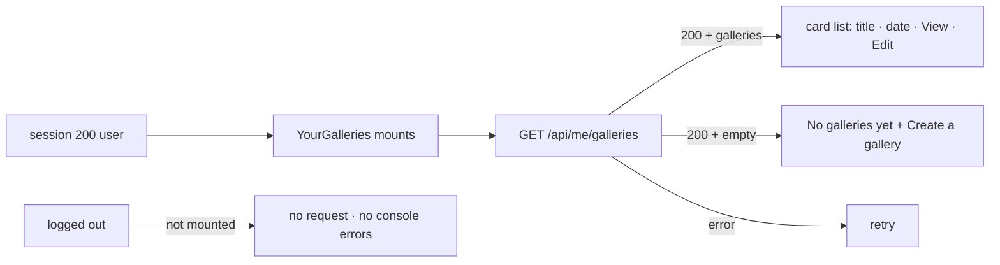

# Handoff: PR-71 / T-122

## Builder notes (designer-2, 2026-10-10)

### What changed

Logged-in creators see their published galleries on the landing page.

- `src/components/landing/YourGalleries.tsx` (new) — `YourGalleries` (mounts only when signed
  in; loading → list / empty / error-with-retry), `GalleryCard` (title, `Intl`-formatted date,
  View via `viewUrl`, Edit via `editUrl`), `YourGalleriesEmpty` ("No galleries yet" + primary
  "Create a gallery"), `formatGalleryDate`. T-111 primitives + tokens only.
- `src/components/auth/authClient.ts` — `listMyGalleries()` for `GET /api/me/galleries`
  (T-102): `{ galleries }` or a friendly error, never throws.
- `src/app/page.tsx` — `<YourGalleries onStartBlank={createBlank} />` mounted only when
  `user` is set (existing `fetchMe`/session state from T-119). Nothing else on the page changed;
  ids/testids/accessible names and strings preserved.

Edit URLs come straight from the owner's own `GET /api/me/galleries` response and are never
logged (no console output), so the key stays private.

### Diagram



### How to test

```bash
git fetch origin && git switch t-122-your-galleries   # or check out PR #71
npm ci
npm run lint && npm run typecheck && npm test
npx playwright test --project=chromium
npm run dev
# register a user, publish a gallery (editor -> Publish), return to /
# -> "Your galleries" shows the card with View + Edit; DevTools console: 0 errors
# log out -> section disappears; console: 0 errors
```

Expected: lint/typecheck/tests green (63 files / 498 tests); chromium e2e 8/8;
logged-in smoke: register 201 → publish 201 → `/api/me/galleries` 200 → card renders with
View/Edit, `consoleErrors: []`; logged-out SSR contains no "Your galleries".

Review focus ideas for reviewer-2: no leaks of edit URLs (owner-only list), empty/loading/error
states, token-only styling, logged-out path makes no request.

## Review rounds

### Round 1
**Verdict** / **Blocking issues** / **Non-blocking suggestions** / **What I tested** — to be filled by reviewer-2.

## DevOps notes
CI result / merge commit / release note — to be filled by devops.
### Round 1 (reviewer, 2026-10-10; claimed): APPROVED
0 blocking. Logged out: hidden, no request, 0 errors. Logged in: newest-first cards, View/Edit work, no key in the console, 390px OK. Non-blocking: duplicate "Create a gallery" name; empty copy says "and your visitors"; T-102 stores the plain edit key in the owner index (flagged to the senior).
