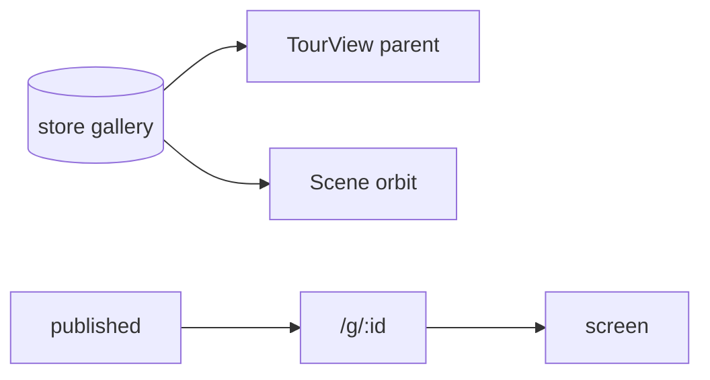

# Handoff: PR-72 / T-124
## Builder notes
### What changed
- **`src/viewer3d/TourView.tsx`:** the `/g/[id]` tour, extracted verbatim, plus `fill` (screen | parent), the "Add a room in 2D" empty state, and a fallback when the current room is deleted. `/g/[id]` renders it unchanged.
- **Editor switcher:** `2D` · `3D POV` · `Top-down`.
  - **POV** = TourView from the live store; edits show immediately.
  - **Top-down** = the old orbit (`view` value `"3d"` kept), starting from above via `topDownStartPosition` in CameraRig.
- **e2e:** `editor.spec.ts` and `matrix.spec.ts` click `Top-down` now.
- **Stretch dropped:** 1/2/3 keys, selection sync, tilt clamp.
### Diagram

### How to test
```bash
git fetch origin && git switch feat/T-124-editor-view-modes && npm ci && npm test
npx playwright test tests/e2e/editor.spec.ts tests/e2e/publish-view.spec.ts
npm run dev
```
1. Open an edit link and switch to **3D POV**.
2. Select a room, either in Top-down or in 2D, and change its wall color: POV updates live. Next and Previous work.
3. **Top-down** starts from above.
4. Check that `/g/<id>` looks and behaves exactly as before.
## Review rounds
### Round 1 (reviewer-3, APPROVED at cc0f0503)
0 blockers; 1 non-blocking note (top-down start centers on orbit target, not plan bbox). Extraction verified line-identical (all handlers, HUD, plaque, nav); POV dynamic-split (no three/howler on 2D load) on live store; "3d" value kept for Top-down; e2e renames applied with no stale refs; 5/5 TourView tests at exact head with fresh npm ci; CI green (Vercel, ci, docs-guard). Limits: no live click-through, no e2e re-run (PROD writes). Full report in PR comment 6101458769; devops notified inside the 16:30 EDT cutoff; card approved.
## E2E evidence (reviewer-3, exact head cc0f0503)
- publish-view chromium LOCAL: PASS (1.5 min, no prod writes).
## DevOps notes
CI result / merge commit / release note
