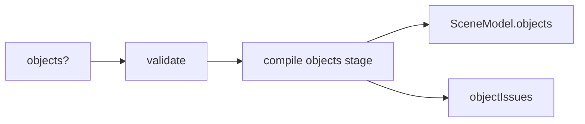

# Handoff: PR-73 / T-128 (part 1: schema, validate, defaults, compile)
## Builder notes
### What changed
- `schema/types.ts`: optional `Gallery.objects` / `Gallery.look`, optional `Room.look` / `wallFinish` / `titleFont`, `GalleryObject`, `ObjectSource`, `GenerationJob` (spec). `Artwork` untouched; `version` stays 1.
- `schema/validate.ts`: zod mirror (Equal<> guard compiles) plus cross checks: room exists, ids unique across artworks and objects, 0.3 m wall margin, footprint ≤ 0.9 × the smaller room side, libraryId in the library. Field rules: height (0, 4], plinth [0, 1.5], rotation [0, 360), depth [0.01, 0.3], non-empty URLs, look literals.
- `schema/defaults.ts`: `OBJECT_LIBRARY` (empty), `newObject()`.
- `compile/objects.ts` (new, pure): `SceneModel.objects` (base on the plinth, rotationY, plinth size ≥ 0.6, render where a non-ready job gives the fallback cutout, inspect view clamped in the room) and the `object-blocks-doorway` warning.
- `compile/compile.ts` + `types.ts`: `SceneModel.objects` always present; warnings in `compile().objectIssues`.
### Deviations (also in the PR)
1. Object warnings go in `objectIssues`, not `issues` (`CompileIssue` is in frames.ts, out of scope; ArtMarkers/ObjectPanel read `artworkId`).
2. `validate(doc, { library })` is injectable: the spec's empty OBJECT_LIBRARY and the round-trip library object conflict.
3. `Minimap.test.tsx`: `objects: []` added to 2 SceneModel test literals.
### Additive proof
`compile/baseline.test.ts` snapshot recorded on unmodified main 5cded67 (commit f11613a); all 3 fixtures still match after the change.
### Diagram

### How to test
`npx vitest run src/lib/schema src/lib/compile` (baseline + 21 new tests); `npx tsc --noEmit`.
### Next
Part 2: store actions + selection + undo + autosave, after T-124 merges.
## Review rounds
### Round 1
**Verdict** / **Blocking issues** / **Non-blocking suggestions** / **What I tested**
## DevOps notes
CI result / merge commit / release note

### DevOps completion
Merged62e70a7bfe3719662b299bf80f2a3fcc3dae66d2 after approved card/review-approved/green ci/docs-guard, production-success and three-minute spacing. Senior cleared independent merge; user explicitly approved bypassing T124 dependency after automatic-review rejection. Normal quality/deploy gates retained.
