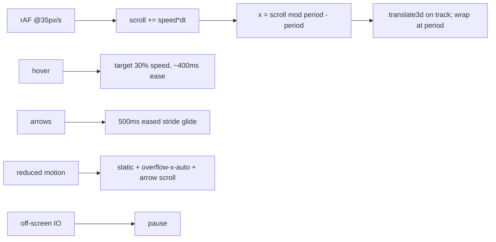

# Handoff: PR-74 / T-129

## Builder notes (designer-2, 2026-10-10)

### What changed

The landing hanging-wall strip is now a seamless left-to-right conveyor belt
(Quang's spec, 15:48 EDT). Only `src/components/landing/Showcase.tsx` changed (+ test).

- **Two identical copies in one track**; `gap-7` is uniform across the copy boundary,
  so the copy1→copy2 join is spaced exactly like every other pair (invisible seam;
  the second copy is `aria-hidden`).
- **Constant drift**: rAF loop, elapsed-time deltas, `35 px/s`, linear, no pauses.
  Track phase `x = (scroll % period) - period`, i.e. `translate3d(-period → 0)` then wraps —
  measured `period` (offset copy1[0]→copy2[0]) makes the wrap exact; equivalent to the
  -50% → 0 spec. `scroll` only ever grows.
- **Measured once + on resize** (period, stride). The loop never reads layout.
- **Hover** → target speed `35 × 0.3 px/s`, eased over ~400 ms (exponential), no stop.
- **Arrows** nudge one `stride` with an eased ~500 ms glide, drift resumes with no jump.
- **prefers-reduced-motion**: no transform; wrapper `overflow-x-auto`; arrows scroll it by
  `±stride` (instant step).
- **Perf**: `will-change: transform` on the track only; IntersectionObserver pauses the loop
  off-screen; deltas clamped to 50 ms (tab-switch spikes).
- Centerline + "145 cm" label fixed; accessible names, buttons and strings unchanged;
  added `data-conveyor-wrapper` marker for the live check (harmless, not a testid).

### Diagram



### How to test

```bash
git fetch origin && git switch t-129-showcase-conveyor   # or check out PR #74
npm ci
npm run lint && npm run typecheck && npm test
npx playwright test --project=chromium
npm run dev   # open / ; watch the strip drift right; hover slows it; arrows nudge
# DevTools > Rendering > Emulate prefers-reduced-motion: strip is static + scrollable
# console: 0 errors
```

Expected: lint/typecheck/tests green (65 files / 515 tests); chromium e2e 8/8;
drift transform increases over time; reduced-motion wrapper `overflow-x: auto` with static
transform; arrows scroll it; no console errors.

Review focus ideas for reviewer: loop correctness (no layout reads, clamp), seamlessness
(measured period + uniform gap), reduced-motion fallback, pause when off-screen.

## Review rounds

### Round 1 (reviewer-3, APPROVED at 65ed4717)
0 blockers, 0 non-blocking. Verified at exact head with fresh npm ci (4/4 unit) plus live local-dev checks at 1440/390/reduced-motion with zero console errors: 35.8 px/s drift, hover slowdown without stop, stride nudge with resumption measured at +35.39 px/s (one interim assertion misfired on glide-tail timing; focused re-run confirms spec-exact behavior, no jump). Engine read clean (measured period/stride, dt clamp, IO pause, decorative-arrow-hidden names). Full report in PR comment 6102001977; devops notified; card approved.

## DevOps notes
CI result / merge commit / release note — to be filled by devops.
## DevOps notes
CI: ci + docs-guard SUCCESS at 65ed471. Merge commit: 6e1cc4f41e8522e0e58139a74e6be7139144850b (squash via devops gate, 2026-10-10T21:15:44Z, head pinned). Card approved + review-approved (reviewer-3). Release note: releases/CHANGELOG.md.
